# CampusCast — Technical Architecture & Schemas

This document details the system architecture, sequence flows, infrastructure layer mapping, and NoSQL Firestore document schemas for CampusCast.

---

## 1. System Sequence Diagrams

### 1.1 Inbound WhatsApp Webhook & Display Sync Flow

```mermaid
sequenceDiagram
    autonumber
    actor Faculty as Authorized Faculty Member (WhatsApp)
    participant Meta as Meta WhatsApp Cloud API
    participant Webhook as Cloud Function (whatsappWebhook)
    participant DB as Cloud Firestore (NoSQL)
    participant Cron as Cloud Function (scheduledNoticeManager)
    participant Display as Display App (display/)
    participant Admin as Admin Command Center (admin/)

    Faculty->>Meta: Send WhatsApp message (e.g. "#urgent #exam ECE: Midterm exam on Monday")
    Meta->>Webhook: Inbound Webhook POST (signed with X-Hub-Signature-256)
    
    rect rgb(20, 30, 50)
        Note over Webhook: 1. HMAC SHA-256 Signature Verification<br/>2. Phone Auth Lookup in `users`<br/>3. Parse Tags (#urgent, #exam, #schedule, DEPT:)
    end

    alt Sender is Unauthorized
        Webhook->>DB: Add document to `audit_log` (type: unauthorized_attempt)
        Note over Webhook: Silent Drop (No WhatsApp reply sent)
    else Sender is Authorized
        Webhook->>DB: Add document to `notices` (status: active/scheduled)
        Webhook->>DB: Add document to `audit_log` (type: publish)
        Webhook-->>Meta: Outbound POST to Graph API ("✅ Posted to ECE")
        Meta-->>Faculty: Deliver WhatsApp Confirmation Reply
    end

    loop Firestore Realtime Stream (onSnapshot)
        DB-->>Display: Push active notice collection updates
        Display->>Display: Render Mode 1 Hero notice card or Mode 3 Emergency Override
    end

    loop Every 1 Minute Cron Ticker
        Cron->>DB: Promote scheduled notices (scheduledAt <= now) -> active
        Cron->>DB: Expire old active notices (expiresAt <= now) -> expired
    end

    Admin->>DB: Read Roster, Screen telemetry, Notice history, & Audit logs
```



---

## 2. Infrastructure Layer Mapping (Zero External Hardware Model)

| Layer | Technology | Operational Function |
|---|---|---|
| **Messaging Ingestion** | Meta WhatsApp Business Cloud API | Webhook payload delivery; outbound confirmation replies. |
| **Serverless Compute** | Firebase Cloud Functions (v2 Node.js) | HMAC SHA-256 validation, phone auth lookup, tag parsing, DB writes. |
| **Billing Plan** | Firebase Blaze Plan (Pay-as-you-go) | Unlocks outbound HTTPS calls to Meta Graph API (`graph.facebook.com`). |
| **Database** | Cloud Firestore (NoSQL) | Notice document storage with native `onSnapshot` streaming listeners. |
| **Frontend Hosting** | Cloudflare Pages | Hosts Next.js 14 display kiosk ([`display/`](file:///d:/Projects/CampusCast/display)) & admin portal ([`admin/`](file:///d:/Projects/CampusCast/admin)). |
| **Display Client** | Smart TV Built-in Web Browser | Direct browser access (`http://<ip>:3000/display?dept=ECE`). **No Pi or Mini-PC required.** |

---

## 3. NoSQL Firestore Schema Specifications

Defined in shared TypeScript contracts at [`packages/shared/src/types.ts`](file:///d:/Projects/CampusCast/packages/shared/src/types.ts).

### Collection: `users/{userId}`
```typescript
interface User {
  id: string;
  name: string;
  phone: string;         // E.164 format e.g. "+919876543210" (Primary Identity)
  role: 'super_admin' | 'hod' | 'faculty';
  departments: string[]; // e.g. ["ECE", "CSE"]
  status: 'active' | 'suspended';
}
```

### Collection: `departments/{deptId}`
```typescript
interface Department {
  id: string;
  name: string;          // e.g. "Electronics & Communication Engineering"
  code: string;          // e.g. "ECE"
  screens: string[];     // Array of registered screen IDs
}
```

### Collection: `screens/{screenId}`
```typescript
interface Screen {
  id: string;
  departmentId: string;  // Foreign key linking screen to department scope
  label: string;         // Human-readable location e.g. "ECE Corridor Smart TV"
  lastSeenAt: number | null; // UNIX timestamp in ms (Updated by heartbeat)
}
```

### Collection: `notices/{noticeId}`
```typescript
type NoticeCategory = 'announcement' | 'event' | 'placement' | 'exam' | 'emergency' | 'achievement';
type NoticePriority = 'normal' | 'urgent';
type NoticeStatus = 'scheduled' | 'active' | 'expired' | 'deleted';

interface Notice {
  id: string;
  departmentId: string;  // Target department code e.g. "ECE" or "ALL"
  title?: string;        // Headline title
  category?: NoticeCategory; // Notice category
  content: string;       // Body text content
  eventDate?: string;    // Formatted event date string e.g. "05 Oct 2026"
  eventTime?: string;    // Formatted event time string e.g. "10:00 AM"
  qrCodeUrl?: string;    // Target QR code link for WhatsApp view
  mediaUrl: string | null;
  mediaType: 'image' | 'pdf' | null;
  priority: NoticePriority; // 'urgent' triggers red alert styling
  status: NoticeStatus;
  createdBy: string;     // Sender phone number or admin identity
  createdAt: number;     // UNIX timestamp in ms
  scheduledAt: number | null;
  expiresAt: number | null;
}
```

### Collection: `audit_log/{logId}`
```typescript
interface AuditLog {
  id: string;
  type: 'publish' | 'unauthorized_attempt' | 'edit' | 'delete' | 'emergency_broadcast';
  actorPhone: string;
  detail: Record<string, any>;
  timestamp: number;
}
```

---

## 4. Security Rules & Data Mutability Invariants

- **Write Operations**: Controlled via [`firestore.rules`](file:///d:/Projects/CampusCast/firestore.rules). In production, notice creation, deletion, and screen telemetry heartbeats write directly to Cloud Firestore (`notices`, `screens`, `audit_log`) and via Cloud Functions (`functions/src/webhook.ts`, `functions/src/heartbeat.ts`).
- **Read Operations**:
  - `notices`: Streamed in real-time via `onSnapshot` queries filtered by department scope (`where('departmentId', 'in', [deptCode, 'ALL'])`).
  - `screens`: Hardware display telemetry updated every 30s and monitored live on the Admin Screen Wall.
  - `departments`: Publicly readable for scope registries and theme tokens.
  - `users` & `audit_log`: Faculty identity roster and compliance action ledger.
- **Offline Fallback Sync**: Display kiosks implement dual-sync persistence (`localStorage` fallback cache + live Firestore WebSocket) ensuring uninterrupted screen rotation during temporary campus Wi-Fi outages.

