# CampusCast — Technical Architecture & Schemas

## 1. System Sequence Diagram

```mermaid
sequenceDiagram
    autonumber
    actor Faculty as Faculty Member (WhatsApp)
    participant Meta as Meta WhatsApp Cloud API
    participant Webhook as Cloud Function (whatsappWebhook)
    participant DB as Cloud Firestore (NoSQL)
    participant Cron as GCP Cloud Scheduler + Function (scheduledNoticeManager)
    participant Display as Display Kiosk (Next.js on Cloudflare Pages)
    participant Admin as Admin Portal (Next.js on Cloudflare Pages)

    Faculty->>Meta: Send WhatsApp message (e.g. "#urgent ECE: Lab shifted to 2 PM")
    Meta->>Webhook: Inbound Webhook POST (signed with X-Hub-Signature-256)
    
    rect rgb(20, 30, 50)
        Note over Webhook: 1. HMAC SHA-256 Signature Verification<br/>2. Phone Auth Lookup in `users`<br/>3. Parse Tags (#urgent, #schedule, DEPT:)
    end

    alt Sender is Unauthorized
        Webhook->>DB: Add doc to `audit_log` (type: unauthorized_attempt)
        Note over Webhook: Silent Drop (No WhatsApp error reply sent)
    else Sender is Authorized
        Webhook->>DB: Add doc to `notices` (status: active/scheduled)
        Webhook->>DB: Add doc to `audit_log` (type: publish)
        Webhook-->>Meta: Outbound POST to Graph API ("✅ Posted to ECE")
        Meta-->>Faculty: Deliver WhatsApp Reply
    end

    loop Firestore Realtime Stream (onSnapshot)
        DB-->>Display: Push active notice collection updates
        Display->>Display: Render high-contrast card (#E5484D red glow for #urgent)
    end

    loop Every 1 Minute Cron Ticker
        Cron->>DB: Promote scheduled notices (scheduledAt <= now) -> active
        Cron->>DB: Expire old active notices (expiresAt <= now) -> expired
    end

    Admin->>DB: Read Roster, Screen telemetry, Notice history, & Audit logs
```



## 2. Infrastructure Layer Mapping

| Layer | Technology | Operational Function |
|---|---|---|
| **Messaging Ingestion** | Meta WhatsApp Business Cloud API | Webhook payload delivery; outbound confirmation replies. |
| **Serverless Compute** | Firebase Cloud Functions (v2 Node.js) | HMAC SHA-256 validation, phone auth lookup, tag parsing, DB writes. |
| **Billing Plan** | Firebase Blaze Plan (Pay-as-you-go) | Unlocks outbound HTTPS calls to Meta Graph API (`graph.facebook.com`). |
| **Database** | Cloud Firestore (NoSQL) | Notice document storage with native `onSnapshot` streaming listeners. |
| **Frontend Hosting** | Cloudflare Pages | Hosts Next.js 14 display kiosk & admin apps with unlimited free bandwidth. |

## 3. NoSQL Firestore Schema Specifications

### Collection: `users/{userId}`
```typescript
interface User {
  id: string;
  name: string;
  phone: string;         // E.164 format e.g. "+919876543210" (Primary Identity)
  role: 'super_admin' | 'hod' | 'faculty';
  departments: string[]; // e.g. ["ECE", "CSE"]
  status: 'active' | 'suspended';
}
```

### Collection: `departments/{deptId}`
```typescript
interface Department {
  id: string;
  name: string;          // e.g. "Electronics & Communication Engineering"
  code: string;          // e.g. "ECE"
  screens: string[];     // Array of registered screen IDs
}
```

### Collection: `screens/{screenId}`
```typescript
interface Screen {
  id: string;
  departmentId: string; // Foreign key linking screen to department scope
  label: string;         // Human-readable location e.g. "ECE Corridor Main Display"
  lastSeenAt: number | null; // UNIX timestamp in ms
}
```

### Collection: `notices/{noticeId}`
```typescript
interface Notice {
  id: string;
  departmentId: string;  // Target department code e.g. "ECE"
  content: string;       // Body text content
  mediaUrl: string | null;
  mediaType: 'image' | 'pdf' | null;
  priority: 'normal' | 'urgent'; // 'urgent' triggers red alert styling
  status: 'scheduled' | 'active' | 'expired' | 'deleted';
  createdBy: string;     // Sender phone number
  createdAt: number;     // UNIX timestamp in ms
  scheduledAt: number | null;
  expiresAt: number | null;
}
```

### Collection: `audit_log/{logId}`
```typescript
interface AuditLog {
  id: string;
  type: 'publish' | 'unauthorized_attempt' | 'edit' | 'delete';
  actorPhone: string;
  detail: Record<string, any>;
  timestamp: number;
}
```
