# CampusCast — Technical Architecture & Schemas

This document details the system architecture, sequence flows, infrastructure layer mapping, and NoSQL Firestore document schemas for CampusCast.

---

## 1. System Sequence Diagrams

### 1.1 Inbound WhatsApp Webhook & Display Sync Flow

```mermaid
sequenceDiagram
    autonumber
    actor Faculty as Authorized Faculty Member (WhatsApp)
    participant Gateway as WhatsApp Gateway (Twilio / Meta API)
    participant Webhook as Serverless Webhook (Vercel / Firebase)
    participant DB as Cloud Firestore (NoSQL)
    participant Cron as 1-Min Lifecycle Cron (Vercel / Cloud Scheduler)
    participant Display as Smart TV Display Kiosks (display/)
    participant Admin as Admin Command Center (admin/)

    Faculty->>Gateway: Send WhatsApp message (e.g. '#urgent #exam ECE: Midterm exam on Monday')
    Gateway->>Webhook: Inbound Webhook POST (Twilio form-data / Meta signed JSON)
    
    rect rgb(20, 30, 50)
        Note over Webhook: 1. Gateway Signature Verification<br/>2. Phone Auth Lookup in 'users' collection<br/>3. Parse Tags (#urgent, #exam, #schedule, DEPT:)
    end

    alt Sender is Unauthorized
        Webhook->>DB: Add document to audit_log (type: unauthorized_attempt)
        Note over Webhook: Silent Drop (No reply sent to prevent phone probing)
    else Sender is Authorized
        Webhook->>DB: Add document to notices (status: active/scheduled)
        Webhook->>DB: Add document to audit_log (type: publish)
        Webhook-->>Gateway: Immediate TwiML or Graph confirmation ('✅ Posted to ECE')
        Gateway-->>Faculty: Deliver WhatsApp Confirmation Reply
    end

    loop Firestore Realtime Stream (onSnapshot)
        DB-->>Display: Push active notice updates (sub-second latency)
        Display->>Display: Render Mode 1 Hero notice card or Mode 3 Emergency Override
    end

    loop Every 1 Minute Cron Ticker
        Cron->>DB: Promote scheduled notices where scheduled time is reached to active
        Cron->>DB: Expire old active notices where expiration time has elapsed to expired
    end

    Admin->>DB: Read Roster, Screen telemetry, Notice history, and Audit logs
```



---

## 2. Infrastructure Layer Mapping (Zero External Hardware & Zero Cloud Cost Model)

| Layer | Technology | Operational Function |
|---|---|---|
| **Messaging Ingestion** | Twilio WhatsApp Sandbox / Meta Cloud API | Webhook payload delivery; instant TwiML/outbound confirmation replies. Twilio Sandbox enables instant zero-verification live texting for evaluation reviews. |
| **Serverless Compute** | Vercel Serverless Route Handlers / Firebase Cloud Functions | HMAC/token validation, phone auth lookup, tag parsing, DB writes. Vercel handlers provide 100% free outbound HTTPS without Blaze plan requirements. |
| **Notice Lifecycle Scheduler** | Vercel Cron Jobs (`vercel.json`) / Cloud Scheduler | 60-second automated ticker to transition scheduled notices and retire expired notices. |
| **Billing / Cost Model** | 100% Free Tier (Vercel Hobby + Twilio Sandbox + Firebase Spark) | Complete end-to-end operation at zero monetary cost. |
| **Database** | Cloud Firestore (NoSQL) | Notice document storage with native `onSnapshot` streaming listeners. |
| **Frontend Hosting** | Vercel Edge / Cloudflare Pages | Hosts Next.js 14 display kiosk ([https://campus-cast-display.vercel.app](https://campus-cast-display.vercel.app)) & admin portal ([https://campus-cast-admin.vercel.app](https://campus-cast-admin.vercel.app)). |
| **Display Client** | Smart TV Built-in Web Browser | Direct browser access (`https://campus-cast-display.vercel.app/display/ece` or local `http://<ip>:3000/display/ece`). **No Pi or Mini-PC required.** |

---

## 3. NoSQL Firestore Schema Specifications

Defined in shared TypeScript contracts at [`packages/shared/src/types.ts`](file:///d:/Projects/CampusCast/packages/shared/src/types.ts).

### Collection: `users/{userId}`
```typescript
interface User {
  id: string;
  name: string;
  phone: string;         // E.164 format e.g. "+919876543210" (Primary Identity)
  role: 'super_admin' | 'hod' | 'faculty';
  departments: string[]; // e.g. ["ECE", "CSE"]
  status: 'active' | 'suspended';
}
```

### Collection: `departments/{deptId}`
```typescript
interface Department {
  id: string;
  name: string;          // e.g. "Electronics & Communication Engineering"
  code: string;          // e.g. "ECE"
  screens: string[];     // Array of registered screen IDs
}
```

### Collection: `screens/{screenId}`
```typescript
interface Screen {
  id: string;
  departmentId: string;  // Foreign key linking screen to department scope
  label: string;         // Human-readable location e.g. "ECE Corridor Smart TV"
  lastSeenAt: number | null; // UNIX timestamp in ms (Updated by heartbeat)
}
```

### Collection: `notices/{noticeId}`
```typescript
type NoticeCategory = 'announcement' | 'event' | 'placement' | 'exam' | 'emergency' | 'achievement';
type NoticePriority = 'normal' | 'urgent';
type NoticeStatus = 'scheduled' | 'active' | 'expired' | 'deleted';

interface Notice {
  id: string;
  departmentId: string;  // Target department code e.g. "ECE" or "ALL"
  title?: string;        // Headline title
  authorName?: string;   // Optional faculty author attribution (e.g. "Dr. Arvind Kulkarni")
  category?: NoticeCategory; // Notice category
  content: string;       // Body text content
  eventDate?: string;    // Formatted event date string e.g. "05 Oct 2026"
  eventTime?: string;    // Formatted event time string e.g. "10:00 AM"
  qrCodeUrl?: string;    // Target QR code link for WhatsApp view
  mediaUrl: string | null;
  mediaType: 'image' | 'pdf' | null;
  priority: NoticePriority; // 'urgent' triggers red alert styling
  status: NoticeStatus;
  createdBy: string;     // Sender phone number or admin identity
  createdAt: number;     // UNIX timestamp in ms
  scheduledAt: number | null;
  expiresAt: number | null;
}
```

### Collection: `audit_log/{logId}`
```typescript
interface AuditLog {
  id: string;
  type: 'publish' | 'unauthorized_attempt' | 'edit' | 'delete' | 'emergency_broadcast';
  actorPhone: string;
  detail: Record<string, any>;
  timestamp: number;
}
```

---

## 4. Security Rules & Data Mutability Invariants

- **Cryptographic Inbound Validation**:
  - Inbound Twilio webhooks are validated with HMAC-SHA1 signature verification (`X-Twilio-Signature`) using `TWILIO_AUTH_TOKEN`.
  - Inbound Meta Cloud API webhooks are verified via HMAC-SHA256 (`X-Hub-Signature-256`) using `META_APP_SECRET` with constant-time buffer comparison (`crypto.timingSafeEqual`) to neutralize timing attacks.
  - Lifecycle Cron (`/api/scheduler`) is guarded by `CRON_SECRET` and `x-vercel-cron` authorization headers.
- **Write Operations & Immutable Ledger**:
  - Controlled via [`firestore.rules`](file:///d:/Projects/CampusCast/firestore.rules).
  - The `audit_log` collection is strictly append-only and immutable (`allow update, delete: if false;`), ensuring non-repudiation for regulatory audits.
  - Notice creation, user modifications, and screen heartbeats enforce schema invariants and data type constraints.
- **PII Masking & Privacy Governance**:
  - Phone numbers are masked across system logs and UI feeds (`maskPhoneNumber()`) e.g. `+91 ••••• ••210`.
  - Unregistered WhatsApp senders trigger silent drops (zero reply) to prevent phone number probing and enumeration.
- **URI XSS Sanitization**:
  - All external poster, document, and QR URLs are validated with `getSafeUrl()` before rendering on Smart TV screens, filtering out `javascript:` and dangerous URI schemes.
- **Read Operations & Sync Architecture**:
  - `notices`: Streamed in real-time via `onSnapshot` queries filtered by department scope (`where('departmentId', 'in', [deptCode, 'ALL'])`).
  - `screens`: Hardware display telemetry updated every 30s and monitored live on the Admin Screen Wall.
  - `departments`: Publicly readable for scope registries and theme tokens.
  - `users` & `audit_log`: Faculty identity roster and compliance action ledger.
- **Offline Fallback Sync**: Display kiosks implement dual-sync persistence (`localStorage` fallback cache + live Firestore WebSocket) ensuring uninterrupted screen rotation during temporary campus Wi-Fi outages.

---

## 5. Smart TV Corridor Display Modes Specification

The CampusCast Smart TV Kiosk client dynamically adapts its viewport layout based on active notice payloads, priority levels, and department scope:

| Display Mode | Mode Key | Architecture & Rendering Pipeline | Trigger Conditions |
| :--- | :--- | :--- | :--- |
| **Adaptive Smart Blocks** | `auto` *(Default)* | Partitions notices by media type into optimal multi-column blocks: visual posters (images/PDFs) on prominent cards and structured text bulletins in side columns. | Default presentation mode on department corridor kiosks (`/display/[deptId]`). |
| **Hero View** | `hero` *(Mode 1)* | Fullscreen spotlight view rendering high-impact headline typography, category badges, event dates, and QR codes with a 10-second auto-carousel. | Single notice emphasis or low-density publishing periods. |
| **News Ticker Marquee** | `news_ticker` *(Mode 2)* | 48px fixed bottom banner running an infinite CSS marquee loop with live notice counter and connectivity indicator. | Continuously running across all corridor displays. |
| **Emergency Override** | `emergency` *(Mode 3)* | Fullscreen high-visibility red alert mode taking immediate priority over all normal displays with pulse animation and audio cue support. | Triggered by PIN-authorized admin broadcast or `priority: 'urgent'` notices. |
| **Split Screen View** | `split` *(Mode 5)* | Dual-pane layout rendering visual media posters on the left viewport (55% width) and structured bulleted notice text on the right (45% width). | Activated for mixed multimedia payloads with long descriptive text. |
| **All Screens Matrix View** | `ALL` scope | Multi-screen 6-tile grid (`ECE`, `CSE`, `AIML`, `MECH`, `CIVIL`, `EEE`) showing real-time active notice streams and hardware telemetry. | Rendered on central campus directory screens (`/display` or `/display/all`). |

---

## 6. Admin Command Center Architecture & Management Pipeline

The CampusCast Admin Command Center ([`apps/admin`](file:///d:/Projects/CampusCast/admin)) provides comprehensive operational control over digital hallway displays and campus notice lifecycles:

### 6.1 In-Place Notice Editing & Lifecycle Management
- **Full In-Place Editing Modal**: Allows administrators to modify any Active, Scheduled, or Archived notice without creating duplicate entries.
- **WhatsApp Notice In-Place Editing**: Enriched support for notices ingested via WhatsApp hotlines, displaying an attribution banner, sanitized sender phone number, and dedicated author attribution field.
- **Editable Metadata**: Headline Title, Faculty Author Attribution (`authorName`), Full Body Content, Target Department Scope (`ALL`, `ECE`, `CSE`, `AIML`, `MECH`, `CIVIL`, `EEE`), Category (`announcement`, `exam`, `placement`, `event`, `achievement`, `emergency`), Media Attachment URLs (with auto-detection and safe URL filtering), Priority (`normal`, `urgent`), Broadcast Status (`active`, `scheduled`, `expired`), and Event Date/Time.
- **Audit Logging**: Every edit automatically writes an immutable audit record to Firestore `audit_log` (`type: 'edit'`) capturing the actor, timestamp, and modification payload.

### 6.2 Multi-Criteria Notice Filtering System
- **Department Scope Selector**: Instant scope filtering across all 6 departments and institution-wide broadcasts.
- **Category Filter Pills**: Filter by notice type (`Announcement`, `Exam`, `Placement`, `Event`, `Achievement`, `Emergency`).
- **Media Attachment Selector**: Filter notices by media capability (`All Media`, `With Image`, `With PDF`, `Text Only`).
- **WhatsApp Submissions Filter**: Dedicated `📱 WhatsApp Submissions` filter toggle to instantly isolate hotline notices.
- **Real-time Query Search**: Sub-string search across titles, descriptions, sender identities, and department scopes with a one-click **Reset** control.
- **Dual-View Support**: Full filtering parity across both visual **Kanban Columns** and structured **Table List Views**.

### 6.3 Hardware Telemetry & Screen Wall
- **Live Stream Listeners**: Real-time Firestore `screens` collection subscriptions rendering live connection statuses and uptime clocks.
- **Continuous Heartbeat Engine**: 20-second telemetry polling maintains active `Online` status indicators across all registered hallway displays.
- **Emergency Broadcast Override**: PIN-protected modal (Dynamic Master PIN: `9482`, configurable in `/settings`) triggers an immediate high-visibility red banner across all corridor screens with zero latency.


