# CampusCast — Master Project Documentation

This is the comprehensive, consolidated master specification for **CampusCast**, uniting all product requirements, architectural sequence flows, database schemas, security rules, visual design guidelines, phase roadmaps, tech stack rationales, and academic literature surveys into a single source of truth.

---

## Table of Contents
1. [Executive Summary & Abstract](#1-executive-summary--abstract)
2. [Product Requirements Document (PRD)](#2-product-requirements-document-prd)
3. [System Architecture & Sequence Flow](#3-system-architecture--sequence-flow)
4. [NoSQL Firestore Data Schemas & Security Rules](#4-nosql-firestore-data-schemas--security-rules)
5. [Visual Design System & Display Kiosk UX](#5-visual-design-system--display-kiosk-ux)
6. [Implementation Phase Plan](#6-implementation-phase-plan)
7. [Technology Stack & Engineering Rationale](#7-technology-stack--engineering-rationale)
8. [Project Memory & Decision History](#8-project-memory--decision-history)
9. [Academic Literature Survey](#9-academic-literature-survey)
10. [References & Citations](#10-references--citations)

---

## 1. Executive Summary & Abstract

# Abstract

College campuses run on notices — lab cancellations, viva reschedules, placement drives, workshop alerts — but the channels carrying them are scattered, manual, and unreliable. A notice pinned to a board goes unseen; a message buried in a 300-member WhatsApp group goes unread; a display that needs a technician to update stops getting updated at all. The result is a communication gap that costs students real opportunities.

CampusCast closes that gap by turning the tool faculty already use every day — WhatsApp — into the publishing interface for a live, department-wide digital notice network. An authorized faculty member sends a message the same way they'd message a colleague; CampusCast authenticates the sender, parses and classifies the content, and pushes it in real time to every LCD display registered to that department, with zero manual upload and zero new software to learn.

The system is built on the WhatsApp Business Cloud API for ingestion, Firebase for real-time state and storage, and lightweight web clients for display rendering — a stack chosen for low operating cost and fast propagation rather than infrastructure complexity. Role-based authorization keeps publishing rights limited to verified numbers; priority tagging, scheduling, and auto-expiry keep the board current without manual cleanup; and department-scoped routing lets one deployment serve an entire campus.

CampusCast's core bet is adoption through familiarity: because the publishing surface is a messaging app faculty are already fluent in, the system removes the single biggest failure point of prior digital-signage efforts — the training and habit-change required to get people to actually use them.


---

## 2. Product Requirements Document (PRD)

# CampusCast — Product Requirements Document (PRD)

## 1. Executive Summary
CampusCast turns WhatsApp into the publishing interface for a real-time, department-scoped digital notice board network. 

Faculty publish announcements by sending a plain WhatsApp text, image, or PDF to an institutional number. CampusCast authenticates the sender, parses priority (`#urgent`) and department tags (`ECE:`), writes the notice to Cloud Firestore (NoSQL), and instantaneously pushes updates to department hallway LCD display screens via real-time `onSnapshot` listeners.

- **Stack**: Firebase Cloud Functions v2 (Blaze Plan) + Cloud Firestore NoSQL + Cloudflare Pages Frontend Hosting.
- **Primary Goal**: $<5$s publish-to-display latency with zero adoption friction for faculty.

---

## 2. Key Architecture & Operational Choices
1. **Firebase Blaze Plan**: Unlocks outbound HTTP requests from Cloud Functions to Meta's WhatsApp Graph API for confirmation replies.
2. **NoSQL Firestore (`onSnapshot`)**: Real-time push listeners for display kiosks with zero polling overhead.
3. **Cloudflare Pages**: Hosts Next.js 14 frontend display and admin applications with unlimited free bandwidth.
4. **Firebase Security**: Enforces strict `allow write: if false;` security rules in `firestore.rules`.
5. **Silent Drops**: Unauthorized senders are recorded in `audit_log` and dropped silently without replying to prevent phone probing.

---

## 3. User Personas & Core Journeys
- **Faculty Publishers**: Send WhatsApp message $\rightarrow$ Receive automated confirmation reply $\rightarrow$ Notice live on screen.
- **Campus Students**: View high-contrast dark theme displays (`#0B1220`) with red alert cards for `#urgent` announcements.
- **HODs & Admins**: Manage faculty roster, screen telemetry heartbeats, notice histories, and audit logs via Next.js Admin Portal.

---

## 4. Non-Functional SLAs & Metrics
- **Publish-to-Display Latency**: $<5$ seconds p95.
- **Display Resilience**: If Wi-Fi drops, screens retain last-rendered state and display `🟡 Reconnecting...` footer indicator. Screens **never go blank**.
- **Security Baseline**: 100% backend-only writes via Firebase Admin SDK.


---

## 3. System Architecture & Sequence Flow

# CampusCast — Architecture Specification (Firebase Blaze + Cloudflare Pages)

## 1. Executive Architecture Summary

CampusCast uses **Firebase Cloud Functions (v2) + Cloud Firestore (NoSQL) on the Firebase Blaze Plan** paired with **Cloudflare Pages** for frontend hosting.

- **Firebase Blaze Plan**: Enables unrestricted outbound HTTPS requests from Cloud Functions to Meta's WhatsApp Cloud API (`graph.facebook.com`), allowing immediate confirmation replies (`"✅ Posted to ECE"`) upon webhook ingestion.
- **NoSQL Firestore (`onSnapshot`)**: Streams live notice updates in real time to hallway LCD display kiosks using zero-polling WebSocket listeners.
- **Cloudflare Pages**: Hosts the Next.js 14 frontend applications (`apps/display` and `apps/admin`) with unlimited free bandwidth and request volume.
- **Firebase Security**: Enforces **zero client-side writes** in `firestore.rules` (`allow write: if false;`). All database mutations run strictly through Firebase Admin SDK in Cloud Functions.

---

## 2. Technology Stack & Infrastructure Mapping

| Component | Technology | Rationale & Configuration |
|---|---|---|
| **Messaging Ingestion** | Meta WhatsApp Business Cloud API | Ingests text, images, PDFs; verified E.164 phone identity. |
| **Serverless Compute** | Firebase Cloud Functions (v2 Node.js) | Ingests webhooks, validates HMAC, parses tags, writes to Firestore. |
| **Billing Plan** | Firebase Blaze Plan (Pay-as-you-go) | Unlocks outbound HTTPS to Meta Graph API; pay-per-use scaling. |
| **Database** | Cloud Firestore (NoSQL) | Real-time `onSnapshot` listeners, zero polling, flexible notice document model. |
| **Real-time Engine** | Firestore `onSnapshot` Stream | Direct push to display kiosk clients on notice creation/expiration. |
| **Media Storage** | Firebase Cloud Storage | Public read for poster images & PDFs; upload via Admin SDK only. |
| **Scheduler** | GCP Cloud Scheduler + `scheduledNoticeManager` | Runs every 1 minute to promote `scheduled` notices and expire old ones. |
| **Security Rules** | `firestore.rules` & `storage.rules` | Strict deny-all client writes (`allow write: if false;`). |
| **Frontend Hosting** | Cloudflare Pages | Unlimited free bandwidth & requests for Next.js 14 display kiosk & admin apps. |

---

## 3. High-Level System Sequence Diagram

```mermaid
sequenceDiagram
    autonumber
    actor Faculty as Faculty Member (WhatsApp)
    participant Meta as Meta WhatsApp Cloud API
    participant Webhook as Cloud Function (whatsappWebhook)
    participant DB as Cloud Firestore (NoSQL)
    participant Cron as GCP Cloud Scheduler + Function (scheduledNoticeManager)
    participant Display as Display Kiosk (Next.js on Cloudflare Pages)
    participant Admin as Admin Portal (Next.js on Cloudflare Pages)

    Faculty->>Meta: Send WhatsApp message (e.g. "#urgent ECE: Lab shifted to 2 PM")
    Meta->>Webhook: Inbound Webhook POST (signed with X-Hub-Signature-256)
    
    rect rgb(20, 30, 50)
        Note over Webhook: 1. HMAC SHA-256 Signature Verification<br/>2. Phone Auth Lookup in `users`<br/>3. Parse Tags (#urgent, #schedule, DEPT:)
    end

    alt Sender is Unauthorized
        Webhook->>DB: Add doc to `audit_log` (type: unauthorized_attempt)
        Note over Webhook: Silent Drop (No WhatsApp error reply sent)
    else Sender is Authorized
        Webhook->>DB: Add doc to `notices` (status: active/scheduled)
        Webhook->>DB: Add doc to `audit_log` (type: publish)
        Webhook-->>Meta: Outbound POST to Graph API ("✅ Posted to ECE")
        Meta-->>Faculty: Deliver WhatsApp Reply
    end

    loop Firestore Realtime Stream (onSnapshot)
        DB-->>Display: Push active notice collection updates
        Display->>Display: Render high-contrast card (#E5484D red glow for #urgent)
    end

    loop Every 1 Minute Cron Ticker
        Cron->>DB: Promote scheduled notices (scheduledAt <= now) -> active
        Cron->>DB: Expire old active notices (expiresAt <= now) -> expired
    end

    Admin->>DB: Read Roster, Screen telemetry, Notice history, & Audit logs
```



---

## 4. NoSQL Firestore Schema Design

### Collection: `users/{userId}`
```typescript
interface User {
  id: string;
  name: string;
  phone: string;        // E.164 phone format e.g. "+919876543210" (Primary Identity)
  role: 'super_admin' | 'hod' | 'faculty';
  departments: string[];// Department codes e.g. ["ECE", "CSE"]
  status: 'active' | 'suspended';
}
```

### Collection: `departments/{deptId}`
```typescript
interface Department {
  id: string;
  name: string;         // e.g. "Electronics & Communication Engineering"
  code: string;         // e.g. "ECE"
  screens: string[];    // Screen IDs
}
```

### Collection: `screens/{screenId}`
```typescript
interface Screen {
  id: string;
  departmentId: string; // Foreign key linking screen to department
  label: string;        // e.g. "ECE Corridor Main Display"
  lastSeenAt: number | null; // UNIX timestamp in ms
}
```

### Collection: `notices/{noticeId}`
```typescript
interface Notice {
  id: string;
  departmentId: string; // Target department code e.g. "ECE"
  content: string;      // Body text
  mediaUrl: string | null;
  mediaType: 'image' | 'pdf' | null;
  priority: 'normal' | 'urgent'; // 'urgent' triggers red alert styling
  status: 'scheduled' | 'active' | 'expired' | 'deleted';
  createdBy: string;    // Sender phone number
  createdAt: number;    // UNIX timestamp in ms
  scheduledAt: number | null;
  expiresAt: number | null;
}
```

### Collection: `audit_log/{logId}`
```typescript
interface AuditLog {
  id: string;
  type: 'publish' | 'unauthorized_attempt' | 'edit' | 'delete';
  actorPhone: string;
  detail: Record<string, any>;
  timestamp: number;
}
```

---

## 5. Security & Operational Rules (`firestore.rules`)

```javascript
rules_version = '2';
service cloud.firestore {
  match /databases/{database}/documents {
    
    // Global Security Baseline: BLOCK ALL CLIENT WRITES across all collections.
    // All writes MUST execute through Firebase Admin SDK in Cloud Functions.
    match /{document=**} {
      allow write: if false;
    }

    // Notices: Public read for active notices
    match /notices/{noticeId} {
      allow read: if resource.data.status == 'active';
    }

    // Departments & Screens: Public read for display kiosks
    match /departments/{deptId} {
      allow read: if true;
    }
    match /screens/{screenId} {
      allow read: if true;
    }

    // Users & Audit Log: Admin read-only
    match /users/{userId} {
      allow read: if request.auth != null;
    }
    match /audit_log/{logId} {
      allow read: if request.auth != null;
    }
  }
}
```


---

# CampusCast — Comprehensive Architecture & Working Guide

This guide provides a complete overview of the **CampusCast** architecture, explaining **why** each component is needed and **how** the entire system operates end-to-end.

---

## 1. Executive Summary & Core Concept

**CampusCast** turns WhatsApp into the publishing interface for a real-time, department-scoped digital notice board network.

- **Problem Addressed**: Physical notice boards require manual printing/posting; WhatsApp groups get buried under noise; existing digital signage panels require faculty to learn new web login portals.
- **The Core Solution**: Faculty publish announcements by sending a plain WhatsApp text, image, or PDF to an institutional number. CampusCast authenticates the sender, parses priority and department tags, writes the notice to a real-time database, and instantaneously renders the notice on department hallway LCD screens.

---

## 2. End-to-End System Sequence Diagram

```mermaid
sequenceDiagram
    autonumber
    actor Faculty as Faculty Member (WhatsApp)
    participant Meta as Meta WhatsApp Cloud API
    participant Webhook as Cloud Function (whatsappWebhook)
    participant DB as Cloud Firestore
    participant Cron as Cloud Function (scheduledNoticeManager)
    participant Display as Display Kiosk (apps/display)
    participant Admin as Admin Portal (apps/admin)

    Faculty->>Meta: Send WhatsApp message (e.g. "#urgent ECE: Lab shifted to 2 PM")
    Meta->>Webhook: Inbound Webhook POST (signed with X-Hub-Signature-256)
    
    rect rgb(20, 30, 50)
        Note over Webhook: 1. HMAC Signature Verification<br/>2. Phone Auth Lookup in `users`<br/>3. Parse Tags (#urgent, #schedule, DEPT:)
    end

    alt Sender is Unauthorized
        Webhook->>DB: Write `audit_log` (type: unauthorized_attempt)
        Note over Webhook: Silent Drop (No WhatsApp error reply sent)
    else Sender is Authorized
        Webhook->>DB: Create Notice doc in `notices` (status: active/scheduled)
        Webhook->>DB: Write `audit_log` (type: publish)
        Webhook-->>Meta: Send WhatsApp Confirmation Reply ("✅ Posted to ECE")
        Meta-->>Faculty: Deliver WhatsApp Reply
    end

    loop Real-Time Listener (onSnapshot)
        DB-->>Display: Stream updated active notices
        Display->>Display: Render high-contrast notice card (Red alert styling for #urgent)
    end

    loop Every 1 Minute Cron Ticker
        Cron->>DB: Promote scheduled notices (scheduledAt <= now) -> active
        Cron->>DB: Expire old active notices (expiresAt <= now) -> expired
    end

    Admin->>DB: Read Roster, Screens telemetry, Notice history, and Audit logs
```



---

## 3. Architecture Breakdown by Package

### 3.1 Shared Domain Package (`packages/shared`)
- **Need**: Maintains a single, immutable source of truth for TypeScript interfaces and deterministic parsing logic shared between Cloud Functions and frontend web clients.
- **Key Modules**:
  - [`src/types.ts`](file:///d:/Projects/CampusCast/packages/shared/src/types.ts): Defines data contracts for `User`, `Department`, `Screen`, `Notice`, `AuditLog`, and `ParsedNoticeMessage`.
  - [`src/parsing.ts`](file:///d:/Projects/CampusCast/packages/shared/src/parsing.ts): Deterministic parser function (`parseNoticeMessage`) that extracts `#urgent`, `#schedule`, and `DEPT:` prefixes using regex.

---

### 3.2 Serverless Backend (`functions`)
Built on Firebase Cloud Functions (v2 Node.js / TypeScript):

1. **`whatsappWebhook` ([`functions/src/webhook.ts`](file:///d:/Projects/CampusCast/functions/src/webhook.ts))**:
   - **Need**: Ingests HTTP webhooks from Meta's WhatsApp Business Cloud API.
   - **Working**:
     - *Handshake*: GET request verifies Meta's `hub.verify_token` challenge.
     - *HMAC Validation*: POST request verifies `X-Hub-Signature-256` SHA-256 header against `WHATSAPP_APP_SECRET`.
     - *Authorization*: Queries `users` collection for `phone == senderPhone` AND `status == 'active'`.
     - *Silent Drop*: Unauthorized senders are recorded in `audit_log` and dropped without replying, preventing phone probing.
     - *Notice Creation*: Saves notice to `notices/{noticeId}` via Firebase Admin SDK.
     - *Reply Dispatch*: Sends automated confirmation WhatsApp reply via Meta Graph API.

2. **`scheduledNoticeManager` ([`functions/src/scheduler.ts`](file:///d:/Projects/CampusCast/functions/src/scheduler.ts))**:
   - **Need**: Manages notice state transitions centrally without relying on display client timers.
   - **Working**: Runs every 1 minute via GCP Cloud Scheduler. Batch-promotes `scheduled` notices to `active` when `scheduledAt <= now`, and demotes `active` notices to `expired` when `expiresAt <= now`.

3. **`screenHeartbeat` ([`functions/src/heartbeat.ts`](file:///d:/Projects/CampusCast/functions/src/heartbeat.ts))**:
   - **Need**: Enables display clients to report operational telemetry.
   - **Working**: Receives screen heartbeats via POST and updates `screens/{screenId}.lastSeenAt`.

---

### 3.3 Hallway Display Web Client (`apps/display`)
- **Need**: Fullscreen 1080p kiosk web application running on LCD displays in campus corridors.
- **Working**:
  - *Real-time Stream*: Subscribes to active notices via Firestore [`onSnapshot`](file:///d:/Projects/CampusCast/apps/display/src/lib/firebase.ts#L48-L86) listener (`status == 'active'`).
  - *Hallway Design*: Visual theme featuring dark background (`#0B1220`), `#141C2E` card background, and minimum 28px font size for hallway viewing.
  - *Urgent Styling*: Notices flagged as `#urgent` render thick red left borders (`#E5484D`), warning badges, and pulse glow animations.
  - *Offline Resilience*: If Wi-Fi drops, the display retains the last rendered notices and shows a `🟡 Reconnecting...` indicator in the footer. **Screens NEVER go blank or render full-page errors.**
  - *Auto-Scroll Pagination*: If cards overflow the screen, smooth auto-scrolling triggers every 8 seconds.

---

### 3.4 Admin Management Portal (`apps/admin`)
- **Need**: Provides Super Admins and HODs with administrative control over faculty publishing permissions and display hardware.
- **Working**:
  - **Roster Tab**: Onboard faculty numbers, set roles (`super_admin` | `hod` | `faculty`), set department scopes, toggle active/suspended status.
  - **Screens Tab**: Monitor registered physical screens and real-time telemetry heartbeat status (`lastSeenAt`).
  - **Notice History Tab**: Search notices across departments and force-expire announcements manually.
  - **Security Audit Tab**: Review immutable audit logs of publishes and blocked unauthorized attempts.

---

## 4. Security & Data Policy Boundaries

1. **Strict Backend-Only Write Rule ([`firestore.rules`](file:///d:/Projects/CampusCast/firestore.rules))**:
   - Client SDKs (Display app and Admin app) are strictly forbidden from writing to Firestore (`allow write: if false;`).
   - All writes execute exclusively through Firebase Admin SDK inside Cloud Functions.
2. **Silent Drop Policy**:
   - Unauthorized senders receive no WhatsApp error reply. This prevents malicious senders from probing registered faculty numbers.
3. **Webhook Payload Integrity**:
   - Webhooks lacking a valid `X-Hub-Signature-256` HMAC hash are rejected immediately with HTTP 403 Forbidden.

---

## 5. Summary of Firestore Data Collections

| Collection | Path | Primary Purpose | Client Access |
|---|---|---|---|
| **Users** | `users/{userId}` | Authorized faculty roster & department scope | Admin Read-only |
| **Departments** | `departments/{deptId}` | Institution department definitions | Public Read |
| **Screens** | `screens/{screenId}` | Hardware display registry & heartbeat timestamps | Public Read |
| **Notices** | `notices/{noticeId}` | Active, scheduled, and expired announcements | Public Read (`status == active`) |
| **Audit Log** | `audit_log/{logId}` | Immutable audit records of publishes & security blocks | Admin Read-only |


---

## 4. NoSQL Firestore Data Schemas & Security Rules

# CampusCast — Development Rules & Constraints

Conventions and non-negotiable boundaries for developers and AI coding assistants working in this repository. Rules marked **[HARD]** must never be violated.

---

## 1. Security & Authorization Rules
- **[HARD]** **No Client-Side Writes**: Display clients and Admin web apps ONLY read from Firestore. All writes (create, update, delete, audit) must execute through Cloud Functions using the Firebase Admin SDK.
- **[HARD]** **Webhook Signature Verification**: Every inbound Meta webhook request must be signature-verified (`X-Hub-Signature-256`) against the app secret before processing. Invalid signatures MUST return 403 Forbidden.
- **[HARD]** **Silent Drop for Unauthorized Senders**: Unauthorized or suspended senders are logged to `audit_log` with `type: 'unauthorized_attempt'` and silently dropped. Never send an error reply to unauthorized numbers.
- **[HARD]** **Secrets Management**: WhatsApp access tokens, app secrets, and service accounts live strictly in environment secrets (`process.env`), never committed to source control or exposed in client bundles.

---

## 2. Parsing & Messaging Rules
- **Forgiving Parser**: Parsing must forgive spacing, casing, and tag order.
- **Supported Tags in v1**: `#urgent`, `#schedule`, and `DEPT:` prefix. Do not add ad-hoc undocumented parsing tags.
- **Department Ambiguity**: If a multi-department faculty member sends a message without a department tag, reply asking for department clarification.

---

## 3. Display Client Rules
- **[HARD]** **Never Go Blank**: On connection failure or listener drop, display clients MUST retain last-known-good rendered state and show a `🟡 Reconnecting...` indicator. Never render full-page error screens.
- **No Client Expiry Timers**: Expiry and scheduling are managed strictly backend-side by `scheduledNoticeManager`. Displays only render notices where `status: "active"`.
- **Hallway Legibility**: Body typography must maintain minimum 28px font size at 1080p reference screen layout.

---

## 4. Code & Architecture Rules
- **TypeScript Strict Mode**: Shared types live in `packages/shared/src/types.ts`. Never duplicate type definitions across packages.
- **Git Commits**: Use semantic commit formatting: `<component>: <description>` (e.g. `functions: verify webhook signature before processing`).

## 5. Content Moderation
- **Out of scope for v1.** The trust model is "only a verified, registered phone number can publish" — not "content is automatically screened." Media is still size/MIME-validated and no executable content is ever rendered (see §1), but there is no profanity, harassment, or misuse filtering on message text or images.
- If this changes, it needs a `PRD.md` update first, not a quiet addition inside `webhook.ts`. The reason to gate it behind a PRD change: filtering has false-positive/false-negative tradeoffs and a review/appeal path that affect faculty trust in the system — that's a product decision, not an implementation detail.


### 4.1 Storage & Access Control Rules
# CampusCast (Rebuild) — Storage Rules

This is the Supabase equivalent of a Firestore `security.rules` file: Postgres **Row-Level Security (RLS)** policies for every table, plus bucket policies for media in Supabase Storage. Every rule here should be applied via a migration file, not clicked together in the dashboard, so it's reviewable and reproducible.

## 1. Principles
- **RLS is enabled on every table, no exceptions.** A table with RLS off is a table the `anon` key can read/write freely — never acceptable here.
- **Only two roles ever touch these tables directly: `anon` (public, used by display clients) and `service_role` (used only inside Edge Functions, never shipped to any client).** The admin web app authenticates via Supabase Auth and gets its own `authenticated` role, scoped separately below.
- **`service_role` bypasses RLS by design** — it's Supabase's server-side key. It must never appear in any client bundle, browser, or public repo. It lives only in the Edge Function's environment secrets.
- **Deny by default.** Every policy below is additive; anything not explicitly granted is denied.

## 2. Enable RLS on everything

```sql
alter table public.departments enable row level security;
alter table public.users       enable row level security;
alter table public.screens     enable row level security;
alter table public.notices     enable row level security;
alter table public.audit_log   enable row level security;
```

## 3. `notices` — the table the public display clients touch

```sql
-- Anyone (anon key, i.e. the display client) can read ACTIVE notices only.
-- This is intentionally public — it's what's meant to be shown on a hallway screen.
create policy "public read active notices"
on public.notices
for select
to anon, authenticated
using (status = 'active');

-- No insert/update/delete for anon or authenticated. Writes only via service_role,
-- which bypasses RLS entirely — no policy needed to grant it, only to NOT grant
-- these operations to anyone else.
```

**Deliberately not exposed:** `scheduled`, `expired`, and `deleted` notices are invisible to the `anon`/`authenticated` roles. A display or admin-app bug can't leak a not-yet-published or deleted notice.

## 4. `departments` and `screens` — read-only reference data

```sql
create policy "public read departments"
on public.departments
for select
to anon, authenticated
using (true);

create policy "public read screens"
on public.screens
for select
to anon, authenticated
using (true);
```

These are non-sensitive (department names/codes, screen labels) — safe to read publicly, useful for the display client to resolve its own department context on load.

## 5. `users` — the sensitive one

```sql
-- No anon access at all. Not even a select policy — anon gets nothing.

-- Authenticated admins can read the roster, but ONLY if their own auth identity
-- is itself a registered active super_admin or hod. This requires linking
-- Supabase Auth users to the `users` table via an `auth_user_id` column
-- (add this column when wiring up the admin app in Phase 2).
create policy "admins read roster"
on public.users
for select
to authenticated
using (
  exists (
    select 1 from public.users u
    where u.auth_user_id = auth.uid()
      and u.role in ('super_admin','hod')
      and u.status = 'active'
  )
);

-- No insert/update/delete for authenticated either — roster changes go through
-- an Edge Function (using service_role) that can enforce additional checks
-- (e.g. only super_admin can create another super_admin) that RLS alone can't
-- express cleanly.
```

## 6. `screens` heartbeat — read is public, writes are function-only

Screens report `last_seen_at` via a small authenticated Edge Function endpoint (not a direct table write from the browser), so no `update` policy is granted to `anon` — the heartbeat function uses `service_role` internally.

## 7. `audit_log` — admins only, nobody writes directly

```sql
create policy "admins read audit log"
on public.audit_log
for select
to authenticated
using (
  exists (
    select 1 from public.users u
    where u.auth_user_id = auth.uid()
      and u.role in ('super_admin','hod')
      and u.status = 'active'
  )
);

-- No write policy for anyone but service_role. Every audit entry is written
-- by the Edge Function that performed the action being logged — never by
-- a client, or the log itself becomes untrustworthy.
```

## 8. Storage bucket — `notice-media`

```sql
-- Create the bucket (via SQL or dashboard), then:

-- Public read — signage needs to display images/PDFs without an auth dance.
create policy "public read notice media"
on storage.objects
for select
to anon, authenticated
using (bucket_id = 'notice-media');

-- No insert/update/delete policy for anon or authenticated.
-- Uploads happen only inside the ingestion Edge Function using service_role,
-- after the file has already been validated (size, MIME type) server-side.
```

**Validation happens before storage, not as a storage rule.** Postgres/Storage policies can't meaningfully inspect file *content* — MIME-type and size checks belong in the Edge Function (reject oversized or wrong-type uploads before they ever reach `notice-media`), not in RLS.

## 9. What this buys us, in one sentence
A faculty member's phone number can get a notice onto a screen — but nothing with only the `anon` key (which is public, ships in every client bundle by design) can ever write a notice, alter the roster, read another user's data, or tamper with the audit trail; only the server-side ingestion function, holding a secret never exposed to any client, can do those things.

## 10. Testing these rules
Before Phase 2 ships, write a short RLS test suite (Supabase supports `pgTAP` or simple scripted assertions): attempt each denied operation as `anon` and confirm it fails, attempt each granted operation and confirm it succeeds. RLS bugs are invisible until someone finds them the hard way — test them like any other security boundary, not by manual spot-checking in the dashboard.


---

## 5. Visual Design System & Display Kiosk UX

# CampusCast (Rebuild) — Design

## 1. Design Principles
1. **Zero learning curve for publishers.** A plain WhatsApp message with no tags must always be valid. `#urgent` and `#schedule` are enhancements, never requirements.
2. **Legible from across a hallway.** Large type, high contrast, minimal simultaneous content — this is a hallway display, not a phone screen.
3. **Never go blank.** A stale screen with a small reconnect indicator beats a blank or error screen every time — Supabase Realtime's WebSocket can drop on flaky campus Wi-Fi; the client must hide that from viewers.
4. **Boring is good for urgent notices.** Red accent, not a strobing animation.

## 2. WhatsApp Message Design

### Plain notice
```
ECE:
Microprocessor Lab cancelled today.
```

### Urgent
```
#urgent
ECE:
Project Review shifted to 2 PM.
```

### Scheduled
```
#schedule 20-09-2026 10:00
ECE:
Workshop starts today.
```

### Confirmation replies (system → faculty)
- Success: `✅ Posted to ECE — visible now.`
- Success (scheduled): `🕒 Scheduled for ECE on 20-09-2026, 10:00 AM.`
- Error, bad department: `❌ "MECH" isn't a recognized department. Reply with one of: ECE, CSE, MECH-ENGG, CIVIL, EEE.`
- Error, unauthorized: *(no reply — silent drop, see `STORAGE_RULES.md` and `PRD.md` FR7)*

## 3. Display Screen Design

### Layout (1920×1080 reference)
```
┌──────────────────────────────────────────────────────────┐
│  ECE DEPARTMENT                          Fri, 21 Aug 2026 │
│  Electronics & Communication Engineering        14:32 IST │  ← Header, 90px
├──────────────────────────────────────────────────────────┤
│   ⚠ URGENT — Project Review shifted to 2 PM               │  ← red left-border card
│   ─────────────────────────────────────────────────────   │
│   Microprocessor Lab cancelled today.                      │  ← normal card
│   Posted 09:14 AM                                          │
│   [ workshop poster image, contained ]                     │  ← media card
├──────────────────────────────────────────────────────────┤
│  Powered by CampusCast              ● 3 active notices     │  ← Footer, 48px
└──────────────────────────────────────────────────────────┘
```

- Stacked cards, priority then recency.
- Overflow content auto-paginates every 8s rather than shrinking text.
- Media renders `object-fit: contain` inside a bounded card, never full-bleed.

### Visual system
| Token | Value | Use |
|---|---|---|
| `--bg` | `#0B1220` | Display background — dark, reduces hallway glare |
| `--card` | `#141C2E` | Notice card background |
| `--text-primary` | `#F5F7FA` | Notice body |
| `--text-secondary` | `#8B96A8` | Timestamps, footer |
| `--accent-urgent` | `#E5484D` | Urgent border/icon |
| `--accent-normal` | `#3B82F6` | Department name, normal accents |
| Font | Inter (system fallback) | Body min 28px, header 40px at 1080p |

## 4. Admin Web App (Supabase Auth-gated)
- **Roster tab:** faculty numbers, department scope, status, add/edit/suspend.
- **Screens tab:** registered screens, last-heartbeat status (green/gray dot), copy display URL.
- **Notices tab:** searchable history, filter by department/status/date, force-expire.
- **Audit tab:** unauthorized attempts and admin actions, read-only.

Login is Supabase Auth (email/password or magic link) — no separate user-management system to build; Supabase's free tier includes this outright.

## 5. Key User Flows

### Faculty publishes a notice
WhatsApp → confirmation reply within seconds → done. No login, no dashboard.

### Admin onboards a new faculty member
Roster → Add → name, phone, department scope, role → publish rights active immediately (identity = phone number, no invite email or password).

### Screen recovers from a dropped connection
Realtime WebSocket drops → client keeps last-rendered notices, shows a small "reconnecting…" indicator → on reconnect, resyncs immediately, no full-screen error state.

## 6. Notes on the stack change vs. the original design
Visually, nothing changes — the dark theme, card layout, and confirmation-message copy all carry over unchanged from the original design. What changes is *only* the plumbing behind "live update": a Supabase Realtime subscription replaces a Firestore `onSnapshot` listener, but from the display component's point of view it's still "subscribe, get pushed changes, render." No UI rework needed for the stack swap.


---

## 6. Implementation Phase Plan

# CampusCast — Implementation Phase Plan (Firebase Blaze + Cloudflare Pages)

Phased development roadmap for building CampusCast with Firebase Cloud Functions (v2 Blaze Plan), Cloud Firestore NoSQL (`onSnapshot`), and Cloudflare Pages.

---

## Phase 0 — Monorepo & Infrastructure Setup [COMPLETED]
- [x] Workspace monorepo setup (`packages/shared`, `functions`, `apps/display`, `apps/admin`).
- [x] Shared TypeScript domain models (`types.ts`) and parser implementation (`parsing.ts`).
- [x] Strict Firebase security rules (`firestore.rules` with `allow write: if false;`, `storage.rules`).
- [x] Local Firebase emulator bindings (`firebase.json`).

## Phase 1 — Ingestion Webhook & Display Client [COMPLETED]
- [x] Ingestion Cloud Function `whatsappWebhook` (v2 Node.js) with `X-Hub-Signature-256` HMAC SHA-256 validation.
- [x] Phone authorization lookup + silent drop for unauthorized senders.
- [x] WhatsApp confirmation reply dispatch via Meta Graph API (unlocked by Firebase Blaze Plan).
- [x] Next.js 14 hallway display app (`apps/display`) configured for Cloudflare Pages deployment.
- [x] Live Firestore `onSnapshot` listener and offline reconnecting indicator (`🟡 Reconnecting...`).
- [x] Live browser subagent verification test on `http://localhost:3000`.

## Phase 2 — Admin Portal & Roster Control [COMPLETED]
- [x] Admin web app (`apps/admin`) with Roster management (add/suspend faculty).
- [x] Display Screen registry and real-time heartbeat telemetry status (`screenHeartbeat`).
- [x] Searchable Notice History and force-expire controls.
- [x] Security & Audit event log UI.

## Phase 3 — Priority, Scheduler & Media Attachments [COMPLETED]
- [x] `#urgent` parsing → red alert notice styling with pulse glow animation (`#E5484D`).
- [x] `#schedule` parsing → scheduled status notices.
- [x] GCP Cloud Scheduler + 1-minute cron Cloud Function `scheduledNoticeManager`.
- [x] Image/PDF media attachment handling and inline card rendering.
- [x] Student-focused notice feeds across ECE, CSE, MECH display routes.

## Phase 4 — Multi-Department Pilot & Cloudflare Pages Rollout [IN PROGRESS]
- [x] Multi-department display routes (`ECE`, `CSE`, `MECH`, `CIVIL`, `EEE`).
- [x] Production build deployment to Cloudflare Pages.
- [ ] End-to-end live testing with real WhatsApp Business production credentials.
- [ ] Hallway hardware display kiosk deployment.

## Phase 5 — System Hardening & Maintenance
- [ ] Inbound Webhook rate limiting per sender.
- [ ] Operational runbooks and telemetry monitoring.


---

## 7. Technology Stack & Engineering Rationale

# CampusCast — Technology Stack & Tooling Rationale

This document provides a technical justification for every framework, database, API, and tool selected for the **CampusCast** platform. It outlines the engineering tradeoffs, architectural advantages, cost considerations, and security benefits that governed each choice.

---

## 1. Summary of Technology Choices

| Architectural Layer | Technology Selected | Primary Engineering Rationale |
|---|---|---|
| **Messaging Ingestion** | Meta WhatsApp Business Cloud API | Adoption through familiarity; zero learning curve for faculty; supports rich media (images, PDFs). |
| **Serverless Backend** | Firebase Cloud Functions (v2, Node.js) | Event-driven execution; zero idle server cost; native IAM integration with database and storage. |
| **Real-Time Data Store** | Cloud Firestore | Native `onSnapshot` real-time listeners; zero polling overhead for display screens; horizontal scalability. |
| **Media Asset Storage** | Firebase Cloud Storage | Decouples binary image/PDF uploads from database document metadata for high query speed. |
| **Display & Admin Web Apps**| Next.js 14 + React 18 + TypeScript | Modern SSR/SPA framework; fast rendering; strict type safety shared across frontends and backend. |
| **Visual Design System** | Vanilla CSS + Tailwind CSS | Full control over high-contrast dark theme (`#0B1220`), hallway distance typography, and urgent red alert styling. |
| **Security Enforcement** | Firestore Security Rules (`allow write: if false`) | Enforces **zero client-side writes**; guarantees all database mutations execute through serverless Admin SDK. |

---

## 2. Ingestion & Messaging Layer: Meta WhatsApp Cloud API

### Why WhatsApp Business Cloud API?
- **Adoption Through Familiarity**: The single biggest point of failure in previous digital signage initiatives is faculty habit change. Asking busy faculty members to log into a separate web dashboard, remember passwords, or download a proprietary app results in low adoption. WhatsApp is already integrated into faculty daily workflows.
- **Rich Media & Formatting**: Supports text announcements, priority tags (`#urgent`), scheduled dates (`#schedule`), event poster images (JPEG/PNG), and official circulars (PDF).
- **Verified Phone Identity**: WhatsApp messages naturally include the sender's E.164 phone number, enabling seamless identity verification without passwords.

### Tradeoffs vs. Alternatives
- **vs. Custom Web Publishing Portal**: A web portal introduces authentication friction (login prompts, password resets, UI navigation). Faculty avoid updating signage if it requires desktop access.
- **vs. SMS / GSM Hardware Modems**: SMS is limited to 160 plain text characters, cannot render poster images or PDFs, requires dedicated physical cellular SIM hardware at every screen, and incurs recurring SMS telco costs.
- **vs. Telegram API**: While Telegram has open API tools, WhatsApp is the dominant institutional messaging channel used daily by faculty and administration in our target deployment environment.

---

## 3. Serverless Backend Layer: Firebase Cloud Functions (v2, Node.js)

### Why Firebase Cloud Functions?
- **Event-Driven Execution**: Campus notice publishing is bursty and low-volume (a few dozen messages per day across campus). Cloud Functions execute only when a Meta webhook event arrives and scale down to zero when idle.
- **Zero Infrastructure Maintenance**: Serverless functions eliminate OS patching, server management, and load balancer configuration.
- **Unified Security Boundary**: Shared IAM project boundary with Firestore, Cloud Storage, and GCP Secret Manager.

### Tradeoffs vs. Alternatives
- **vs. Always-On Dedicated Server (Express on Railway / Render / AWS EC2)**: A persistent server incurs continuous 24/7 billing even during zero-traffic periods (overnight, weekends, academic breaks). Cloud Functions eliminate idle infrastructure costs.

---

## 4. Real-Time Data Layer: Cloud Firestore

### Why Cloud Firestore?
- **Real-Time Push Synchronization (`onSnapshot`)**: Department display screens run fullscreen kiosk browsers. Firestore's `onSnapshot` listener pushes database changes to display screens instantaneously.
- **Zero Polling Overhead**: Eliminates periodic HTTP polling (`setInterval(fetchNotices, 5000)`), reducing network bandwidth, display CPU usage, and server request loads.
- **Flexible Document Schema**: Native support for notice status lifecycles (`scheduled`, `active`, `expired`, `deleted`), arrays of department scopes, and audit logging.

### Tradeoffs vs. Alternatives
- **vs. Relational Databases (MySQL / PostgreSQL)**: Relational databases do not natively stream document state updates to browser clients. Achieving real-time display updates with SQL requires managing custom WebSocket connections (e.g. Socket.io) and scaling WebSocket connection servers.

---

## 5. Frontend Kiosk & Administration Layer: Next.js 14 & Tailwind CSS

### Why Next.js 14 & TypeScript?
- **Hallway Kiosk Performance**: Fast client hydration and optimized routing for department screens (`/display/ece`, `/display/cse`, `/display/mech`).
- **Unified Monorepo (`@campuscast/shared`)**: Shared TypeScript interfaces (`User`, `Notice`, `Screen`, `AuditLog`) prevent API contract drift between backend functions and frontend components.
- **Utility-First Styling (Tailwind CSS)**: Allows precise design of the dark visual theme (`#0B1220` display background, `#141C2E` notice cards, `#E5484D` urgent glow borders), ensuring hallway legibility at a distance of 10+ meters.

---

## 6. Security Architecture & Policy Tooling

### 1. `firestore.rules` (`allow write: if false;`)
- **Rationale**: Prevents malicious users or compromised browser clients from mutating database documents. Display screens and Admin portals only have read access; all database writes execute through the Firebase Admin SDK in Cloud Functions.

### 2. HMAC SHA-256 Webhook Verification (`X-Hub-Signature-256`)
- **Rationale**: Validates that inbound HTTP webhook requests originate from Meta's servers and have not been spoofed or modified by external attackers.

### 3. Silent Drop for Unauthorized Numbers
- **Rationale**: If an unregistered phone number sends a message, the system logs an `unauthorized_attempt` to `audit_log` and drops the request without replying. This prevents unauthorized users from probing registered faculty numbers.


---

## 8. Project Memory & Decision History

# CampusCast — Project Memory

Persistent context for human developers and AI agents working on CampusCast.

---

## 1. What This Project Is
CampusCast turns WhatsApp into the publishing interface for a real-time, department-scoped digital notice board network.
- **Messaging**: Meta WhatsApp Business Cloud API.
- **Backend Compute**: Firebase Cloud Functions (v2 Node.js / TypeScript) on the **Firebase Blaze Plan** (pay-as-you-go, unlocking outbound HTTP calls to Meta Graph API).
- **Database**: Cloud Firestore (NoSQL) with real-time `onSnapshot` streaming listeners.
- **Frontend Hosting**: Cloudflare Pages (unlimited free bandwidth for Next.js display and admin apps).
- **Security**: Enforces **zero client-side writes** in `firestore.rules` (`allow write: if false;`).

---

## 2. Key Decisions Locked In
1. **Firebase Blaze Plan**: Used to allow Cloud Functions to make outbound HTTPS calls to Meta Graph API (`https://graph.facebook.com`) for confirmation replies.
2. **Identity = Phone Number**: No password/login system for faculty. Their WhatsApp number is their verified credential.
3. **Backend-Only Writes**: Display & Admin clients ONLY read. All writes go through Cloud Functions using the Firebase Admin SDK.
4. **Silent Drop for Unauthorized Senders**: Unauthorized senders are logged to `audit_log` and dropped without replying to prevent phone number probing.
5. **Dark Theme Display Kiosks**: Designed for hallway glare reduction (`#0B1220` background, `#141C2E` cards, `#E5484D` urgent red alert glow).
6. **Offline Resilience**: Display clients never go blank or render full-screen errors on connection loss; they retain last-known-good state (`🟡 Reconnecting...`).
7. **Cloudflare Pages Frontend Hosting**: Hosts Next.js 14 display kiosk and admin apps with unlimited free bandwidth.

---

## 3. Decision Log
| Date | Decision | Why |
|---|---|---|
| 2026-08-21 | Selected Firebase Cloud Functions + Firestore NoSQL | Cost + infra simplicity for low, bursty traffic |
| 2026-08-21 | Added Admin web app surface | Roster/screen management can't live in a DB console past pilot |
| 2026-08-22 | Verified live display client via automated browser subagent tests at `http://localhost:3000` | Verified multi-department student notice displays, clock tick, and reconnect status indicators |
| 2026-08-26 | Confirmed Firebase Blaze Plan + NoSQL Firestore (`onSnapshot`) + Cloudflare Pages architecture | Blaze Plan unlocks outbound HTTPS calls to Meta API; Cloudflare Pages provides unlimited frontend bandwidth |


---

## 9. Academic Literature Survey

# Literature Survey & Proposed CampusCast Implementation (Ranked by Relevance)

> 📌 **Relevance Ranking**: Papers are ordered from **Most Directly Relevant** (WhatsApp API, Real-Time Cloud Digital Notice Boards) to **Broad Architectural Context** (Smart Campus frameworks & systematic reviews).

| Rank | Title paper [Year] | Research Parameter | Methodology | Findings | Limitations | Proposed Implementation in CampusCast |
|---|---|---|---|---|---|---|
| 1 | **WhatsApp Integrated Information System on Student Attendance Management [2025]** | Develop WhatsApp API-based attendance management system with instant parent notifications | Web-based admin system integrated with WhatsApp API, sequential SDLC model | Real-time student tracking; significantly improves school-parent communication; high adoption rate | Application specific to attendance tracking; limited to single academic use case | Extend WhatsApp Business API integration beyond single attendance notifications to a full-fledged campus notice dissemination engine. Implement WhatsApp webhook handlers to receive multi-format notices (text messages, event poster images, PDF circulars), automatically parse notice metadata (priority: Urgent/High/Normal, target department), and route them to real-time LCD signage nodes across campus. |
| 2 | **Employee Attendance Application at Universitas Muhammadiyah Sidoarjo Based on WhatsApp [2025]** | Develop WhatsApp-based employee attendance and notification system | Web application with WhatsApp Gateway API, iterative SDLC development methodology | Improved administrative efficiency; minimized human data entry errors; high user adoption | Application specific to employee attendance; restricted to institution-specific workflows | Capitalize on WhatsApp’s near-universal adoption among faculty and administrative staff to eliminate adoption friction. By allowing staff to publish notices directly through their existing WhatsApp chat app without logging into web panels or downloading custom mobile apps, CampusCast maximizes content contribution efficiency while using verified phone numbers for seamless multi-factor authentication. |
| 3 | **Integrasi WhatsApp Gateway dan Cloud Computing pada Sistem Absensi Digital Terpadu Siswa (SAGITA) [2026]** | Design cloud-based student information system with WhatsApp broadcasting | Google Workspace backend, Google Apps Script automation, WhatsApp Gateway API integration | Real-time broadcast capabilities; successfully handled 1,186 students across 38 study groups; cloud scalable | Tailored for attendance broadcasting; heavily dependent on Google Workspace cloud ecosystem | Scale cloud message distribution by combining a cloud backend with asynchronous WebSocket push event channels. Map registered faculty phone numbers to department display units (e.g., ECE, CSE, Mech), ensuring that when a faculty member sends a WhatsApp notice, it is automatically validated, stored in cloud database, and instantly pushed to the corresponding department LCD displays without manual routing overhead. |
| 4 | **A Multi-Modal IoT-Based Attendance System Using RFID and WhatsApp Notification [2025]** | Create smart academic attendance platform combining RFID hardware and WhatsApp alerts | RFID reader, ESP32 microcontroller, CallMeBot WhatsApp API, multi-modal feedback | Secure physical session control; real-time push notifications via WhatsApp; enhanced user interaction | Requires dedicated physical RFID hardware; specific to attendance logging | Implement a multi-modal alert broadcast pipeline on department LCD screens. For high-priority or emergency notices received via WhatsApp (e.g., exam schedule shifts or class cancellations), CampusCast triggers visually prominent high-contrast red warning banners and synchronized audio alerts on display screens alongside real-time WhatsApp notifications to students. |
| 5 | **Real-Time Cloud Based Smart Digital Notice Board [2025]** | Create cloud-based digital notice board with priority setting and remote web management | Raspberry Pi controller, ESP8266 Wi-Fi module, cloud server, web interface portal | Real-time display updates; flexible priority setting; message scheduling support; web-based remote control | Dependent on web portal publishing; no direct integration with mobile messaging APIs (WhatsApp) | Modernize conventional cloud web admin panels by building a WhatsApp chatbot interface acting as the primary publishing controller. Faculty can broadcast, schedule, or prioritize notice displays straight from their smartphones, while Raspberry Pi-powered display nodes connect via persistent WebSocket sockets to render instant updates with fallback local offline caching. |
| 6 | **A Modular and Event-Driven Platform for Real-Time Sensor Data Integration in Smart Campus Environments [2025]** | Address IoT sensor data integration and real-time event routing in smart campuses | Modular event-driven architecture, proof-of-concept software platform implementation | Improves modularity, flexibility, and rapid development compared to monolithic architectures | Qualitative proof-of-concept demonstration; requires broader large-scale validation | Architect an event-driven Node.js backend using Webhook handlers and WebSocket channels. When a WhatsApp notice payload arrives from Meta’s WhatsApp API, the backend emits a real-time NOTICE_PUBLISHED event that instantly broadcasts the notice payload to all connected department signage nodes with sub-second latency. |
| 7 | **Guiding the design and implementation of interactive public displays in educational settings [2024]** | Define design goals and content creation workflows for interactive public displays in education | Co-design workshops, deployment studies, qualitative user behavior analysis | Identified seven core design goals; centralized publishing improves adoption; display location impacts engagement | Lower than expected end-user interactive engagement; content moderation overhead for staff | Solve staff content generation barriers highlighted in public display research by establishing a zero-friction publishing workflow. CampusCast turns faculty WhatsApp messages into formatted digital signage slides automatically, embedding auto-layout typography, timestamps, priority tags, and faculty credentials without requiring manual graphic design work. |
| 8 | **Smart Campus Event Management System [2026]** | Automate campus event management using modern microservices and real-time notifications | Spring Boot microservices, RabbitMQ message broker, MySQL, JWT authentication | Drastically reduces manual administrative work; increases student participation; scalable microservice architecture | Focused exclusively on event management; not adaptable as a general digital notice board | Adapt microservice event routing concepts to incorporate Role-Based Access Control (RBAC). CampusCast validates the sender’s phone number against institutional database roles (Admin, HOD, Professor, Assistant Professor), granting publishing authorization and assigning notice priority levels accordingly (e.g., HOD notices receive High Priority display slots). |
| 9 | **Implementation of GSM Wireless Technology Based Remote Notice Board [2024]** | Develop GSM-based remote notice board for real-time alerts and remote message management | GSM modem interfaced with microcontroller, SMS-based message transmission | System works reliably in GSM coverage areas; user-friendly SMS management; cost-effective deployment | Limited to text SMS; no multimedia (image/PDF) support; requires GSM signal coverage | Upgrade text-only GSM SMS notice boards by replacing SMS modems with cloud-based WhatsApp Business API integration. This enables rich media support (high-res images, PDF documents, formatted text), eliminates hardware SIM modems and recurring SMS charges, and leverages Wi-Fi/Ethernet for reliable HD display broadcasting. |
| 10 | **Integrated IoT Based Smart Notice Board [2025]** | Modernize traditional notice boards using microcontrollers and IoT environmental sensors | Arduino Uno with Bluetooth HC-05 module, DHT11 sensor, LCD display | Enables remote updates via smartphone; environmentally friendly; modular hardware design | Bluetooth range limitations (~10 meters); no cloud integration; restricted to basic text | Overcome Bluetooth range limitations (~10 meters) and basic text constraints by replacing short-range Bluetooth updating with cloud WebSockets over Wi-Fi. Raspberry Pi display controllers receive continuous, remote cloud updates from anywhere globally whenever authorized faculty send WhatsApp messages. |
| 11 | **Design and Development of a Smart Wireless Electronic Notice Board System [2021]** | Replace paper-based notice boards with wireless electronic system and authenticated access | Dual GSM and Bluetooth modules interfaced with Arduino, LCD display, buzzer alert | Cost-effective architecture; authenticated access; eliminates paper waste; reduces latency | Dual-mode hardware complexity; limited display screen size; lacks message scheduling | Eliminate complex dual GSM/Bluetooth hardware setups by leveraging WhatsApp's verified phone number infrastructure for secure authentication. Integrate backend timestamp-based scheduled publishing and automatic notice expiration, clearing outdated notices automatically from screen rotation. |
| 12 | **GSM Based Smart Digital Wireless Electronic Notice Board [2022]** | Create low-cost wireless digital notice board using GSM technology | GSM modem interfaced with microcontroller, SMS message receiving, LCD display | Low cost; nationwide/worldwide remote message publishing via SMS; suitable for schools and colleges | SMS character length limits (160 chars); text-only (no images/PDFs); recurring SMS charges | Expand restrictive 160-character SMS text bounds to full multimedia broadcasts. Faculty can attach PDF circulars, lab schedule images, and detailed announcements via WhatsApp, which CampusCast formats and renders on full-color HD department displays without recurring cellular SMS costs. |
| 13 | **Wireless Electronic Notice Board using GSM [2021]** | Develop GSM-synchronized high-visibility wireless LED matrix display board | GSM modem, shift register ICs, ATmega microcontroller, 8x40 dot matrix LED display | Immediate remote notice delivery; superior visibility compared to paper; enhances security awareness | LED matrix hardware display restrictions; lacks cloud storage; tied strictly to GSM SMS format | Replace low-resolution monochrome LED dot-matrix boards with high-definition color LCD smart displays. CampusCast displays multi-region layouts including an active notice viewport, animated scrolling ticker for urgent alerts, live clock/weather widgets, and department branding. |
| 14 | **Design of Smart Campus Management System Based on Internet of Things Technology [2021]** | Develop comprehensive IoT-based smart campus management system architecture | Multi-layered IoT technology integration framework, layered hardware-software architecture | IoT connectivity enables smart institutional services; improves campus operational efficiency | Broad architectural scope; lacks specific focus on real-time notice dissemination | Design a lightweight, department-aware routing layer mapping faculty phone numbers to targeted campus display screens (e.g., ECE Department, CSE Department, Central Library), preventing information clutter by ensuring notices appear on relevant physical displays. |
| 15 | **Towards a Smart & Sustainable Campus: An Application-Oriented Architecture [2021]** | Streamline smart campus development using Application-Oriented Architecture (AoA) | AoA conceptual model, three real-world academic case studies (RnMonitor, Refill_H2O, BiRa) | Multi-application interoperability; seamless data sharing; supports legacy and new system coexistence | Implementation complexity; heavy infrastructure dependency on FIWARE platform | Deliver a low-cost, eco-friendly digital notice system that completely eliminates paper, ink, and manual posting overhead. By running on energy-efficient Raspberry Pi display nodes connected to commercial TV/LCD monitors, CampusCast provides a sustainable digital transformation for educational campuses. |
| 16 | **Smart Campus Communication, Internet of Things, and Data [2022]** | Examine datafication of student activity and communication flow on smart campuses | Dialectical communication-centered approach, empirical campus study | Communication-centered approach is vital; data integration improves campus engagement | Heavy focus on data privacy and policy; limited technical system implementation | Build a communication-first notification engine tailored for campus urgency. The system prioritizes critical notices (e.g., exam venue changes, urgent meeting calls) while maintaining automated audit logging of published notices for administrative oversight and compliance. |
| 17 | **Smart Campus: Definition, Framework, Technologies, and Services [2020]** | Define smart campus framework and IoT technology integration standards | Systematic literature review, multi-layer framework conceptual development | IoT extends connectivity across physical devices; enables intelligent automated campus services | High-level generic framework; lacks specific notice board or communication implementation details | Translate theoretical smart campus framework concepts into a practical software application. CampusCast integrates WhatsApp API messaging webhooks, Node.js cloud middleware, and distributed LCD hardware nodes into a cohesive campus communication ecosystem. |
| 18 | **Internet of Things for Smart Spaces: A University Campus Case Study [2020]** | Deploy and evaluate long-term open space IoT communication on a university campus | 331 LoRaWAN sensor nodes deployment, long-term empirical data analysis and visualization | Evaluated real-world deployment lessons; identified data quality challenges; validated campus IoT viability | High failure rates in harsh multi-user environments; sensor data calibration and quality issues | Address network reliability and node failure risks by implementing local storage caching (SQLite/IndexedDB) on Raspberry Pi display nodes. In the event of Wi-Fi or Internet loss, the display node continues rendering cached active notices seamlessly until connectivity is restored. |
| 19 | **Promoting Digital Campus to Smart Campus Based on Artificial Intelligence [2022]** | Propose structured multi-tier AI and IoT framework for digital campus transformation | Five-tier framework conceptual model, practical institutional application implementation | AI enhances smart campus automation; provides structured roadmap for digital transformation | Focused primarily on AI analytics; limited coverage of notice display and communication channels | Incorporate smart regex and natural language parsing logic in the backend to auto-detect notice priority (keywords like URGENT, ATTENTION), target departments, and auto-expiration dates directly from faculty WhatsApp message text formatting. |
| 20 | **A Systematic Review on Technologies and Applications in Smart Campus [2022]** | Conduct systematic literature review of smart campus technologies and human-centered applications | Systematic literature review (SLR) methodology, human-centered case study classification | Comprehensive technology landscape taxonomy; identifies key research gaps and future application domains | Review paper; does not introduce a novel hardware/software implementation | Directly address research gaps identified in literature by unifying mobile messaging (WhatsApp API), cloud real-time event distribution (WebSockets), role-based security (RBAC), and dynamic digital LCD signage into a single user-friendly platform. |

---

## 10. References & Citations

# References & Research Paper Sources

**Total Referenced Papers**: 25
**Downloaded PDF Files**: 10

| # | Title | Authors & Year | Publisher / DOI | PDF Status | Local File / Web Link |
|---|---|---|---|---|---|
| 1 | **IoT-Based Smart Notice Board & Class Schedule Notification System with Real-Time Classroom Environment Monitoring Facility** | A. Mondal, P. Dutta, and R. Saha (2023) | Springer Nature (Lecture Notes in Networks and Systems)<br>[10.1007/978-981-19-9719-8_13](https://doi.org/10.1007/978-981-19-9719-8_13) | 🌐 Open Access / Purchase required / Institutional Access | [Publisher Link](https://link.springer.com/chapter/10.1007/978-981-19-9719-8_13) |
| 2 | **Internet of Things and Its Applications to Smart Campus: A Systematic Literature Review** | N. Cavus, S. E. Mrwebi, I. Ibrahim, T. Modupeola, and A. Y. Reeves (2022) | iJIM (International Journal of Interactive Mobile Technologies)<br>[10.3991/ijim.v16i23.36215](https://doi.org/10.3991/ijim.v16i23.36215) | ✅ Downloaded PDF | [`pdf/02_internet_of_things_and_its_applications_to_smart_c.pdf`](file:///d:/Major Project 2/papers/pdf/02_internet_of_things_and_its_applications_to_smart_c.pdf) |
| 3 | **An IoT system for a smart campus: Challenges and solutions illustrated over several real-world use cases** | T. Domínguez-Bolaño, V. Barral, C. J. Escudero, and J. A. García-Naya (2024) | Elsevier (Internet of Things Journal) / arXiv Preprint<br>[10.1016/j.iot.2024.101099](https://doi.org/10.1016/j.iot.2024.101099) | ✅ Downloaded PDF | [`pdf/03_an_iot_system_for_a_smart_campus.pdf`](file:///d:/Major Project 2/papers/pdf/03_an_iot_system_for_a_smart_campus.pdf) |
| 4 | **Testing and Evaluation of Low-Cost Sensors for Developing Open Smart Campus Systems Based on IoT** | P. Neis, D. Warch, and M. Hoppe (2023) | MDPI Sensors<br>[10.3390/s23208652](https://doi.org/10.3390/s23208652) | 🌐 Open Access / FREE - MDPI Open Access (Browser Access Required) | [Publisher Link](https://www.mdpi.com/1424-8220/23/20/8652) |
| 5 | **LoRaWAN for Smart Campus: Deployment and Long-Term Operation Analysis** | R. Yasmin, K. Mikhaylov, and A. Pouttu (2020) | MDPI Sensors<br>[10.3390/s20236721](https://doi.org/10.3390/s20236721) | 🌐 Open Access / FREE - MDPI Open Access (Browser Access Required) | [Publisher Link](https://www.mdpi.com/1424-8220/20/23/6721) |
| 6 | **Toward an Intelligent Campus: IoT Platform for Remote Monitoring and Control of Smart Buildings** | M. A. Ahmed, S. A. Chavez, A. M. Eltamaly et al. (2022) | MDPI Sensors<br>[10.3390/s22239045](https://doi.org/10.3390/s22239045) | 🌐 Open Access / FREE - MDPI Open Access (Browser Access Required) | [Publisher Link](https://www.mdpi.com/1424-8220/22/23/9045) |
| 7 | **Towards a Smart & Sustainable Campus: An Application-Oriented Architecture to Streamline Digitization** | P. Martins, S. I. Lopes, A. M. R. da Cruz, and A. Curado (2021) | MDPI Sustainability<br>[10.3390/su13063189](https://doi.org/10.3390/su13063189) | 🌐 Open Access / FREE - MDPI Open Access (Browser Access Required) | [Publisher Link](https://www.mdpi.com/2071-1050/13/6/3189) |
| 8 | **Internet of Things for Smart Spaces: A University Campus Case Study** | E. Gilman, S. Tamminen, R. Yasmin, E. Ristimella et al. (2020) | MDPI Sensors<br>[10.3390/s20133716](https://doi.org/10.3390/s20133716) | 🌐 Open Access / FREE - MDPI Open Access (Browser Access Required) | [Publisher Link](https://www.mdpi.com/1424-8220/20/13/3716) |
| 9 | **Smart Campuses: Extensive Review of the Last Decade of Research and Current Challenges** | N. Chagnon-Lessard et al. (2021) | IEEE Access<br>[10.1109/ACCESS.2021.3114286](https://doi.org/10.1109/ACCESS.2021.3114286) | 🌐 Open Access / FREE - IEEE Access Open Access | [Publisher Link](https://ieeexplore.ieee.org/document/9538036) |
| 10 | **WhatsApp-Based Intervention for Diabetes Prevention and Care Program in Argentina's Public Health System** | A. Nejamis et al. (2025) | JMIR Formative Research<br>[10.2196/81098](https://doi.org/10.2196/81098) | ✅ Downloaded PDF | [`pdf/10_whatsapp_based_intervention_for_diabetes_preventio.pdf`](file:///d:/Major Project 2/papers/pdf/10_whatsapp_based_intervention_for_diabetes_preventio.pdf) |
| 11 | **The role of push notifications in shaping students' engagement, self-regulation, and academic procrastination** | B. B. Mumcu and Ö. Demir (2025) | Springer Open (Int. J. Educ. Technol. High. Educ.)<br>[10.1186/s41239-025-00537-x](https://doi.org/10.1186/s41239-025-00537-x) | ✅ Downloaded PDF | [`pdf/11_the_role_of_push_notifications_in_shaping_students.pdf`](file:///d:/Major Project 2/papers/pdf/11_the_role_of_push_notifications_in_shaping_students.pdf) |
| 12 | **On the introduction of intelligent alerting systems to reduce e-learning dropout** | R. M. M. F. Luis, J. M. S. Torres, and A. C. V. de Paiva (2022) | Springer Open (Smart Learning Environments)<br>[10.1186/s40561-022-00210-0](https://doi.org/10.1186/s40561-022-00210-0) | ✅ Downloaded PDF | [`pdf/12_on_the_introduction_of_intelligent_alerting_system.pdf`](file:///d:/Major Project 2/papers/pdf/12_on_the_introduction_of_intelligent_alerting_system.pdf) |
| 13 | **Establish a Digital Real-Time Learning System With Push Notifications** | Frontiers in Psychology (2022) | Frontiers in Psychology<br>[10.3389/fpsyg.2022.767389](https://doi.org/10.3389/fpsyg.2022.767389) | ✅ Downloaded PDF | [`pdf/13_establish_a_digital_real_time_learning_system_with.pdf`](file:///d:/Major Project 2/papers/pdf/13_establish_a_digital_real_time_learning_system_with.pdf) |
| 14 | **Implementation of the WhatsApp API Notification Feature in the Final Project Management System** | UMSIDA Archive (2023) | UMSIDA Archive<br>[10.21070/ups.3071](https://doi.org/10.21070/ups.3071) | 🌐 Open Access / FREE - Repository Open Access | [Publisher Link](https://archive.umsida.ac.id/index.php/archive/preprint/view/3071) |
| 15 | **Web-Based Student Violation Management with Real-Time Notifications Transforms School Discipline** | IJLER (2024) | IJLER / UMSIDA<br>[10.21070/ijler.2024.1196](https://doi.org/10.21070/ijler.2024.1196) | 🌐 Open Access / FREE - Open Access | [Publisher Link](https://ijler.umsida.ac.id/index.php/ijler/article/view/1196) |
| 16 | **Penerapan Api Whatsapp Fonnte Untuk Sistem Pengingat Jadwal Bimbingan Tugas Akhir Mahasiswa Berbasis Web** | I. M. B. Waton, A. N. Weking, and B. Deta (2025) | ResearchHub (J. Tek. Mesin, Elektro dan Ilmu Komput.)<br>[10.55606/teknik.v5i2.7614](https://doi.org/10.55606/teknik.v5i2.7614) | 🌐 Open Access / FREE - Open Access | [Publisher Link](https://researchhub.id/index.php/teknik/article/view/7614) |
| 17 | **Design of smart campus management system based on internet of things technology** | W. Li, X. Yuan, and M. Elhoseny (2020) | IOS Press (Journal of Intelligent & Fuzzy Systems)<br>[10.3233/JIFS-189354](https://doi.org/10.3233/JIFS-189354) | 🌐 Open Access / Purchase required / Institutional Access | [Publisher Link](https://content.iospress.com/articles/journal-of-intelligent-and-fuzzy-systems/jifs189354) |
| 18 | **Guiding the design and implementation of interactive public displays in educational settings** | M. Müller, N. Otero, and M. Milrad (2024) | Springer (Journal of Computers in Education)<br>[10.1007/s40692-023-00280-0](https://doi.org/10.1007/s40692-023-00280-0) | ✅ Downloaded PDF | [`pdf/18_guiding_the_design_and_implementation_of_interacti.pdf`](file:///d:/Major Project 2/papers/pdf/18_guiding_the_design_and_implementation_of_interacti.pdf) |
| 19 | **Wireless Smart Notice Board** | V. M. Manoj, M. Tharun, N. S. Naveen, and S. Bhaskar (2023) | IJARCCE<br>[10.17148/IJARCCE.2023.125143](https://doi.org/10.17148/IJARCCE.2023.125143) | 🌐 Open Access / FREE - Open Access | [Publisher Link](https://ijarcce.com/papers/wireless-smart-notice-board/) |
| 20 | **A Lightweight LMS Architecture for Mobile Learning Using PHP And WhatsApp APIs** | I. M. B. Waton, A. N. Weking, and B. Deta (2026) | NOESIS Publications (JCSTE)<br>[10.65496/jcste.2026.65](https://doi.org/10.65496/jcste.2026.65) | ✅ Downloaded PDF | [`pdf/20_a_lightweight_lms_architecture_for_mobile_learning.pdf`](file:///d:/Major Project 2/papers/pdf/20_a_lightweight_lms_architecture_for_mobile_learning.pdf) |
| 21 | **Internet of Thing for Smart Campus: Systematic Literature Review** | B. Noviansyah and L. Lestary (2024) | Atlantis Press (iCAST-ES)<br>[10.2991/978-94-6463-364-1_59](https://doi.org/10.2991/978-94-6463-364-1_59) | ✅ Downloaded PDF | [`pdf/21_internet_of_thing_for_smart_campus_systematic_lite.pdf`](file:///d:/Major Project 2/papers/pdf/21_internet_of_thing_for_smart_campus_systematic_lite.pdf) |
| 22 | **Design and Implementation of IoT Technology of a Smart Campus with Visual Simulation Tool** | P. Wijonarko, A. Salam, B. James, and A. Ibadurrahman (2023) | SciTePress (ISCP UTA '45)<br>[10.5220/0012640800003821](https://doi.org/10.5220/0012640800003821) | 🌐 Open Access / FREE - Open Access | [Publisher Link](https://www.scitepress.org/Documents/2023/126408/) |
| 23 | **Creating Smart Campus: The Future University Campus Based on IoT and Global Positioning System (GPS)** | T. Iftikhar (2024) | SciTechnol (J. Comput. Eng. Inf. Technol.)<br>[10.4172/2324-9307.1000306](https://doi.org/10.4172/2324-9307.1000306) | 🌐 Open Access / FREE - Open Access | [Publisher Link](https://www.scitechnol.com/peer-review/creating-smart-campus-the-future-university-campus-based-on-iot-and-global-positioning-system-gps-s8qn.php?article_id=26344) |
| 24 | **IoT Enabled Real-Time Vehicle Tracking and Alert System for Educational Transport Service** | E. Barath, J. S. S. Hirthicik, B. Devanathan, and S. A. Lakshmanan (2025) | IEEE (ICOECA Conference)<br>[10.1109/icoeca66273.2025.00057](https://doi.org/10.1109/icoeca66273.2025.00057) | 🌐 Open Access / Purchase required / Institutional Access | [Publisher Link](https://ieeexplore.ieee.org/document/11012345) |
| 25 | **Real-Time Cloud Based Smart Digital Notice Board** | A. Shrivastava, A. Wanve, A. Deshpande, and S. Chavan (2025) | IJIRT<br>N/A | ✅ Downloaded PDF | [`pdf/25_real_time_cloud_based_smart_digital_notice_board.pdf`](file:///d:/Major Project 2/papers/pdf/25_real_time_cloud_based_smart_digital_notice_board.pdf) |

