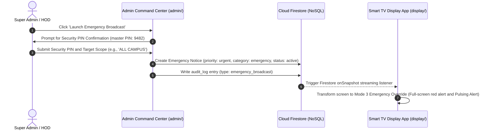
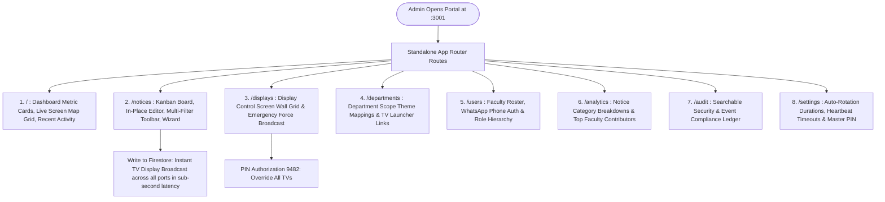

# CampusCast — Comprehensive System Architecture & Working Guide

This document provides an exhaustive, minute-by-minute technical blueprint of the **CampusCast Campus Communication Operating System**. It covers the platform domain model, serverless architecture, security invariants, sequence flows, and complete **App Flow** specifications for both the **Smart TV Display App** and the **Admin Command Center**.

---

## 1. Executive Summary & Core Concept

**CampusCast** turns WhatsApp into an authenticated publishing interface for a real-time, department-scoped digital notice board network, backed by a modern **Campus Communication Operating System**.

- **Problem Addressed**: Traditional physical notice boards require manual printing, paper posting, and physical maintenance; WhatsApp student groups suffer from noise, chat fragmentation, and lost circulars; existing commercial digital signage platforms force faculty to navigate complex web admin portals with forgotten passwords.
- **The Core Solution**: Authorized faculty members publish announcements by sending a plain WhatsApp text message, poster image (JPEG/PNG), or PDF circular to an institutional WhatsApp number. CampusCast authenticates the sender by phone identity, parses priority (`#urgent`), category (`#exam`, `#event`, `#placement`, `#achievement`), and department tags (`ECE:`), writes the notice to Cloud Firestore (NoSQL), and pushes updates to department hallway Smart TV displays in real time.
- **Zero-Hardware Smart TV Model**: Kiosk displays run inside the native web browser of any Smart TV (Android TV, LG webOS, Samsung Tizen OS, Fire TV) connected to campus Wi-Fi or Ethernet. **No Raspberry Pi, Mini-PC, HDMI dongles, or power bricks required.**

---

## 2. End-to-End System Sequence Diagrams

### 2.1 WhatsApp Ingestion & Real-Time Broadcast Sequence

```mermaid
sequenceDiagram
    autonumber
    actor Faculty as Authorized Faculty Member (WhatsApp)
    participant Meta as Meta WhatsApp Cloud API
    participant Webhook as Cloud Function (whatsappWebhook)
    participant DB as Cloud Firestore (NoSQL)
    participant Cron as Cloud Function (scheduledNoticeManager)
    participant Display as Smart TV Display App (display/)
    participant Admin as Admin Command Center (admin/)

    Faculty->>Meta: Send WhatsApp message (e.g. '#urgent #exam ECE: Midterm exam on Monday')
    Meta->>Webhook: Inbound Webhook POST (signed with X-Hub-Signature-256)
    
    rect rgb(20, 30, 50)
        Note over Webhook: 1. HMAC SHA-256 Signature Verification<br/>2. Phone Auth Lookup in 'users' collection<br/>3. Parse Tags (#urgent, #exam, #schedule, DEPT:)
    end

    alt Sender is Unauthorized / Suspended
        Webhook->>DB: Add document to audit_log (type: unauthorized_attempt)
        Note over Webhook: Silent Drop (No WhatsApp reply sent to prevent probing)
    else Sender is Authorized & Active
        Webhook->>DB: Create Notice doc in notices (status: active/scheduled)
        Webhook->>DB: Add document to audit_log (type: publish)
        Webhook-->>Meta: Outbound POST to Graph API ('✅ Posted to ECE')
        Meta-->>Faculty: Deliver WhatsApp Confirmation Reply
    end

    loop Firestore Realtime Stream (onSnapshot)
        DB-->>Display: Push active notice collection updates to display screens
        Display->>Display: Render Mode 1 Hero card or Mode 3 Emergency Override
    end

    loop Every 1 Minute Cron Ticker
        Cron->>DB: Promote scheduled notices where scheduledAt is reached to active
        Cron->>DB: Expire old active notices where expiresAt has elapsed to expired
    end

    Admin->>DB: Read Roster, Screen telemetry, Kanban board, and Audit logs
```



### 2.2 Admin Emergency Alert Override Sequence



---

## 3. Workspace Architecture Breakdown

```text
CampusCast/
├── display/             # Public Digital Signage Notice Board Web App (Next.js 14)
│   ├── src/app/         # App Router pages (/display, /display/[deptId])
│   ├── src/components/  # Header, Footer, NoticeCard, EmergencyOverrideView, SplitScreenView
│   └── src/lib/         # Firebase Client SDK & Firestore `onSnapshot` subscriber
├── admin/               # Administrative Command Center (Next.js 14)
│   ├── src/app/         # App Router page (Dashboard, Kanban, Screen Wall, Wizard)
│   └── src/lib/         # Firestore Client SDK for Admin portal
├── functions/           # Firebase Cloud Functions (v2 Node.js - Serverless Webhooks)
│   ├── src/webhook.ts   # Ingests WhatsApp Cloud API webhooks & validates HMAC SHA-256
│   ├── src/scheduler.ts # 1-minute cron job managing notice state transitions
│   └── src/heartbeat.ts # Screen telemetry heartbeat endpoint
├── packages/shared/     # Shared TypeScript Domain Package
│   ├── src/types.ts     # Data models for User, Notice, Screen, AuditLog, DepartmentTheme
│   └── src/parsing.ts   # Deterministic WhatsApp tag parsing engine
├── Docs/                # Exhaustive System Documentation & IT Runbooks
└── firestore.rules      # Deny-all client-side write security policy
```

---

## 4. Detailed App Flows & User Experience

### 4.1 Smart TV Display App Flow ([`display/`](file:///d:/Projects/CampusCast/display))

The Display App runs on Smart TV screens in campus corridors with **Poppins** typography, department scope color themes, and 5 distinct Display Modes:


#### Detailed Breakdown of the Display Experience Modes:

1. **Adaptive Smart Multi-Media View (Default View)**:
   - Dynamic viewport partitioning: visual poster attachments (PNG/JPEG) are allocated prominent 7-column spotlight showcase blocks, while PDF circulars generate clean official document cards with instant QR code mobile download links.
   - Text announcements render in high-impact typographic cards formatted with Poppins typography and department theme accents.
   - Full un-truncated titles, complete descriptive content, event dates (`📅 15 Oct 2026`), and event times (`⏰ 10:00 AM`).

2. **Mode 1: Hero Notice View**:
   - Occupies **80%** of viewport space.
   - Renders headline title, full notice text, category badge (`EXAM`, `PLACEMENT`, `EVENT`, `URGENT`, `ACHIEVEMENT`), date/time chips, department badge, and interactive WhatsApp QR code snippet (`Scan QR for details`).
   - Auto-rotates featured notice cards every **10 seconds** with smooth keyframe transitions.

3. **Mode 2: News Ticker Marquee (Bottom Marquee)**:
   - Always-visible 48px bottom scrolling marquee ticker bar with live active notice counters and connectivity indicators.

4. **Mode 3: Emergency Override View**:
   - Triggered automatically when `priority == 'urgent'` or `category == 'emergency'`.
   - Transforms the entire screen into a full-bleed red alert display (`#DC2626`).
   - Displays bold emergency headlines, body text, issuer signatures, and pulsating alert animation. Normal notice carousels are temporarily paused.

5. **Mode 4: Event Carousel View**:
   - Auto-sliding carousel for poster images, event banners, and PDF circulars.

6. **Mode 5: All Screens Matrix Overview (`/display/all` & `/display`)**:
   - Multi-screen 6-tile matrix view rendering real-time active notice streams and live hardware telemetry across all 6 departments (`ECE`, `CSE`, `AIML`, `MECH`, `CIVIL`, `EEE`).

---

### 4.2 Campus Communication Command Center Flow ([`admin/`](file:///d:/Projects/CampusCast/admin))

The Admin Portal is architected with **8 dedicated standalone Next.js App Router pages** (zero in-memory tab state resets on browser refresh):



#### Exhaustive Module Specs:

1. **Dashboard Command Center**:
   - System Metric Cards: `Total Screens (6)`, `Online Screens (6/6)`, `Active Notices (28)`, `Registered Faculty (5)`.
   - Live Screen Map Grid: Displays real-time online status pills (`ECE Screen 🟢 Online`, `CSE Screen 🟢 Online`, `AIML Screen 🟢 Online` with continuous 20s telemetry).

2. **Notice Management & Real-time Filtering (`/notices`)**:
   - **Visual Kanban Board**: Drag-and-drop functional columns (`Scheduled`, `Active on Kiosks`, `Expired / Archived`).
   - **Table List View**: Structured data table with direct activation, expiration, and deletion controls.
   - **Multi-Criteria Filter Toolbar**:
     - *Department Scope Pills*: (`All Scopes`, `Campus-wide (ALL)`, `ECE`, `CSE`, `AIML`, `MECH`, `CIVIL`, `EEE`).
     - *Category / Notice Type Selector*: (`All Types`, `Announcement`, `Exam`, `Placement`, `Event`, `Achievement`, `Emergency`).
     - *Media Attachment Filter*: (`All Media`, `With Image`, `With PDF`, `Text Only`).
     - *Instant Search*: Real-time substring filtering across headline titles, descriptions, authors, and scopes with an active filter counter and one-click `Reset` button.
   - **In-Place Notice Editing Modal**:
     - Edit any notice directly from Kanban cards or table rows (including inbound WhatsApp hotline submissions).
     - Displays emerald WhatsApp source banner and provides faculty author name (`authorName`) editing.
     - Modify Headline, Body text, Department Scope, Category, Media URL (sanitized via `getSafeUrl()`), Priority (`Normal`, `Urgent`), Broadcast Status (`Active`, `Scheduled`, `Expired`), and Event Date/Time.
     - Syncs directly with Firestore and logs an audit trail record (`type: 'edit'`).

3. **Notice Creation Wizard Modal**:
   - 3-step structured creation wizard with real-time smart layout preview and instant publication scheduling.

4. **Display Control Center & Screen Wall (`/displays`)**:
   - Screen Wall Grid showing screen label, ID, resolution (`1080p`), live heartbeat timestamp, and direct display launcher link.
   - PIN-Protected Force Broadcast Modal (`9482` master PIN, configurable in Settings) to launch campus-wide emergency overrides.

5. **Analytics Module (`/analytics`)**:
   - Notice Analytics: Total published notices, category distribution, department breakdown, peak posting hours.
   - Faculty Analytics: Top contributor rankings, notices posted per faculty member.

6. **Faculty Roster (`/users`)**:
   - Onboarding modal for new faculty numbers (`E.164` format).
   - Role hierarchy badges (`Super Admin` -> `HOD` -> `Faculty`).
   - One-click **Suspend / Activate** buttons for instant emergency phone lockouts.

7. **Security Audit Trail (`/audit`)**:
   - Searchable, immutable chronological log of all WhatsApp publishes, notice edits, deletions, direct admin broadcasts, and blocked probing attempts.

---

## 5. Security Invariants & Access Controls

1. **Strict Client Deny-All Write Rule ([`firestore.rules`](file:///d:/Projects/CampusCast/firestore.rules))**:
   - Web frontend clients ([`display/`](file:///d:/Projects/CampusCast/display) and [`admin/`](file:///d:/Projects/CampusCast/admin)) cannot perform client-side writes to Firestore (`allow write: if false;`). All writes execute via serverless Cloud Functions or secure server routes.
2. **HMAC SHA-256 Webhook Verification**:
   - Inbound HTTP POST requests from Meta's WhatsApp Cloud API verify the `X-Hub-Signature-256` HMAC header against `WHATSAPP_APP_SECRET`.
3. **Silent Drop Policy**:
   - Unregistered phone numbers are logged in `audit_log` and dropped silently without sending a WhatsApp reply, preventing phone probing.

---

## 6. Summary of Firestore Collections

| Collection | Path | Primary Purpose | Client Access |
|---|---|---|---|
| **Users** | `users/{userId}` | Authorized faculty roster & department scope | Admin Read-Only |
| **Departments** | `departments/{deptId}` | Institution department definitions & theme colors | Public Read |
| **Screens** | `screens/{screenId}` | Hardware display registry & heartbeat timestamps | Public Read |
| **Notices** | `notices/{noticeId}` | Active, scheduled, and expired announcements | Public Read (`status == active`) |
| **Audit Log** | `audit_log/{logId}` | Immutable audit records of publishes & security blocks | Admin Read-Only |

---
*CampusCast Documentation © 2026 — Built for MIT College of Engineering*
