# CampusCast — Comprehensive Architecture & Working Guide

This guide provides a complete overview of the **CampusCast** architecture, explaining **why** each component is needed and **how** the entire system operates end-to-end.

---

## 1. Executive Summary & Core Concept

**CampusCast** turns WhatsApp into the publishing interface for a real-time, department-scoped digital notice board network.

- **Problem Addressed**: Physical notice boards require manual printing/posting; WhatsApp groups get buried under noise; existing digital signage panels require faculty to learn new web login portals.
- **The Core Solution**: Faculty publish announcements by sending a plain WhatsApp text, image, or PDF to an institutional number. CampusCast authenticates the sender, parses priority and department tags, writes the notice to a real-time database, and instantaneously renders the notice on department hallway LCD screens.

---

## 2. End-to-End System Sequence Diagram

```mermaid
sequenceDiagram
    autonumber
    actor Faculty as Faculty Member (WhatsApp)
    participant Meta as Meta WhatsApp Cloud API
    participant Webhook as Cloud Function (whatsappWebhook)
    participant DB as Cloud Firestore
    participant Cron as Cloud Function (scheduledNoticeManager)
    participant Display as Display Kiosk (apps/display)
    participant Admin as Admin Portal (apps/admin)

    Faculty->>Meta: Send WhatsApp message (e.g. "#urgent ECE: Lab shifted to 2 PM")
    Meta->>Webhook: Inbound Webhook POST (signed with X-Hub-Signature-256)
    
    rect rgb(20, 30, 50)
        Note over Webhook: 1. HMAC Signature Verification<br/>2. Phone Auth Lookup in `users`<br/>3. Parse Tags (#urgent, #schedule, DEPT:)
    end

    alt Sender is Unauthorized
        Webhook->>DB: Write `audit_log` (type: unauthorized_attempt)
        Note over Webhook: Silent Drop (No WhatsApp error reply sent)
    else Sender is Authorized
        Webhook->>DB: Create Notice doc in `notices` (status: active/scheduled)
        Webhook->>DB: Write `audit_log` (type: publish)
        Webhook-->>Meta: Send WhatsApp Confirmation Reply ("✅ Posted to ECE")
        Meta-->>Faculty: Deliver WhatsApp Reply
    end

    loop Real-Time Listener (onSnapshot)
        DB-->>Display: Stream updated active notices
        Display->>Display: Render high-contrast notice card (Red alert styling for #urgent)
    end

    loop Every 1 Minute Cron Ticker
        Cron->>DB: Promote scheduled notices (scheduledAt <= now) -> active
        Cron->>DB: Expire old active notices (expiresAt <= now) -> expired
    end

    Admin->>DB: Read Roster, Screens telemetry, Notice history, and Audit logs
```

---

## 3. Architecture Breakdown by Package

### 3.1 Shared Domain Package (`packages/shared`)
- **Need**: Maintains a single, immutable source of truth for TypeScript interfaces and deterministic parsing logic shared between Cloud Functions and frontend web clients.
- **Key Modules**:
  - [`src/types.ts`](file:///d:/Projects/CampusCast/packages/shared/src/types.ts): Defines data contracts for `User`, `Department`, `Screen`, `Notice`, `AuditLog`, and `ParsedNoticeMessage`.
  - [`src/parsing.ts`](file:///d:/Projects/CampusCast/packages/shared/src/parsing.ts): Deterministic parser function (`parseNoticeMessage`) that extracts `#urgent`, `#schedule`, and `DEPT:` prefixes using regex.

---

### 3.2 Serverless Backend (`functions`)
Built on Firebase Cloud Functions (v2 Node.js / TypeScript):

1. **`whatsappWebhook` ([`functions/src/webhook.ts`](file:///d:/Projects/CampusCast/functions/src/webhook.ts))**:
   - **Need**: Ingests HTTP webhooks from Meta's WhatsApp Business Cloud API.
   - **Working**:
     - *Handshake*: GET request verifies Meta's `hub.verify_token` challenge.
     - *HMAC Validation*: POST request verifies `X-Hub-Signature-256` SHA-256 header against `WHATSAPP_APP_SECRET`.
     - *Authorization*: Queries `users` collection for `phone == senderPhone` AND `status == 'active'`.
     - *Silent Drop*: Unauthorized senders are recorded in `audit_log` and dropped without replying, preventing phone probing.
     - *Notice Creation*: Saves notice to `notices/{noticeId}` via Firebase Admin SDK.
     - *Reply Dispatch*: Sends automated confirmation WhatsApp reply via Meta Graph API.

2. **`scheduledNoticeManager` ([`functions/src/scheduler.ts`](file:///d:/Projects/CampusCast/functions/src/scheduler.ts))**:
   - **Need**: Manages notice state transitions centrally without relying on display client timers.
   - **Working**: Runs every 1 minute via GCP Cloud Scheduler. Batch-promotes `scheduled` notices to `active` when `scheduledAt <= now`, and demotes `active` notices to `expired` when `expiresAt <= now`.

3. **`screenHeartbeat` ([`functions/src/heartbeat.ts`](file:///d:/Projects/CampusCast/functions/src/heartbeat.ts))**:
   - **Need**: Enables display clients to report operational telemetry.
   - **Working**: Receives screen heartbeats via POST and updates `screens/{screenId}.lastSeenAt`.

---

### 3.3 Hallway Display Web Client (`apps/display`)
- **Need**: Fullscreen 1080p kiosk web application running on LCD displays in campus corridors.
- **Working**:
  - *Real-time Stream*: Subscribes to active notices via Firestore [`onSnapshot`](file:///d:/Projects/CampusCast/apps/display/src/lib/firebase.ts#L48-L86) listener (`status == 'active'`).
  - *Hallway Design*: Visual theme featuring dark background (`#0B1220`), `#141C2E` card background, and minimum 28px font size for hallway viewing.
  - *Urgent Styling*: Notices flagged as `#urgent` render thick red left borders (`#E5484D`), warning badges, and pulse glow animations.
  - *Offline Resilience*: If Wi-Fi drops, the display retains the last rendered notices and shows a `🟡 Reconnecting...` indicator in the footer. **Screens NEVER go blank or render full-page errors.**
  - *Auto-Scroll Pagination*: If cards overflow the screen, smooth auto-scrolling triggers every 8 seconds.

---

### 3.4 Admin Management Portal (`apps/admin`)
- **Need**: Provides Super Admins and HODs with administrative control over faculty publishing permissions and display hardware.
- **Working**:
  - **Roster Tab**: Onboard faculty numbers, set roles (`super_admin` | `hod` | `faculty`), set department scopes, toggle active/suspended status.
  - **Screens Tab**: Monitor registered physical screens and real-time telemetry heartbeat status (`lastSeenAt`).
  - **Notice History Tab**: Search notices across departments and force-expire announcements manually.
  - **Security Audit Tab**: Review immutable audit logs of publishes and blocked unauthorized attempts.

---

## 4. Security & Data Policy Boundaries

1. **Strict Backend-Only Write Rule ([`firestore.rules`](file:///d:/Projects/CampusCast/firestore.rules))**:
   - Client SDKs (Display app and Admin app) are strictly forbidden from writing to Firestore (`allow write: if false;`).
   - All writes execute exclusively through Firebase Admin SDK inside Cloud Functions.
2. **Silent Drop Policy**:
   - Unauthorized senders receive no WhatsApp error reply. This prevents malicious senders from probing registered faculty numbers.
3. **Webhook Payload Integrity**:
   - Webhooks lacking a valid `X-Hub-Signature-256` HMAC hash are rejected immediately with HTTP 403 Forbidden.

---

## 5. Summary of Firestore Data Collections

| Collection | Path | Primary Purpose | Client Access |
|---|---|---|---|
| **Users** | `users/{userId}` | Authorized faculty roster & department scope | Admin Read-only |
| **Departments** | `departments/{deptId}` | Institution department definitions | Public Read |
| **Screens** | `screens/{screenId}` | Hardware display registry & heartbeat timestamps | Public Read |
| **Notices** | `notices/{noticeId}` | Active, scheduled, and expired announcements | Public Read (`status == active`) |
| **Audit Log** | `audit_log/{logId}` | Immutable audit records of publishes & security blocks | Admin Read-only |
