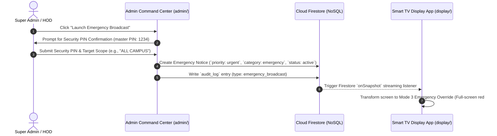
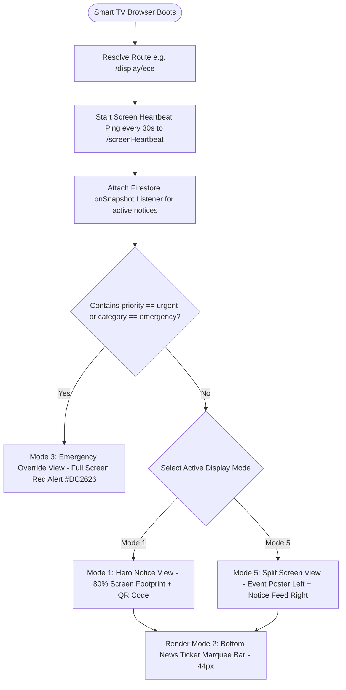
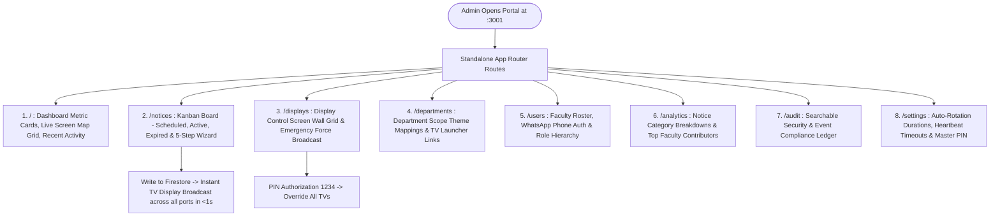

# CampusCast — Comprehensive System Architecture & Working Guide

This document provides an exhaustive, minute-by-minute technical blueprint of the **CampusCast Campus Communication Operating System**. It covers the platform domain model, serverless architecture, security invariants, sequence flows, and complete **App Flow** specifications for both the **Smart TV Display App** and the **Admin Command Center**.

---

## 1. Executive Summary & Core Concept

**CampusCast** turns WhatsApp into an authenticated publishing interface for a real-time, department-scoped digital notice board network, backed by a modern **Campus Communication Operating System**.

- **Problem Addressed**: Traditional physical notice boards require manual printing, paper posting, and physical maintenance; WhatsApp student groups suffer from noise, chat fragmentation, and lost circulars; existing commercial digital signage platforms force faculty to navigate complex web admin portals with forgotten passwords.
- **The Core Solution**: Authorized faculty members publish announcements by sending a plain WhatsApp text message, poster image (JPEG/PNG), or PDF circular to an institutional WhatsApp number. CampusCast authenticates the sender by phone identity, parses priority (`#urgent`), category (`#exam`, `#event`, `#placement`, `#achievement`), and department tags (`ECE:`), writes the notice to Cloud Firestore (NoSQL), and pushes updates to department hallway Smart TV displays in real time.
- **Zero-Hardware Smart TV Model**: Kiosk displays run inside the native web browser of any Smart TV (Android TV, LG webOS, Samsung Tizen OS, Fire TV) connected to campus Wi-Fi or Ethernet. **No Raspberry Pi, Mini-PC, HDMI dongles, or power bricks required.**

---

## 2. End-to-End System Sequence Diagrams

### 2.1 WhatsApp Ingestion & Real-Time Broadcast Sequence

```mermaid
sequenceDiagram
    autonumber
    actor Faculty as Authorized Faculty Member (WhatsApp)
    participant Meta as Meta WhatsApp Cloud API
    participant Webhook as Cloud Function (whatsappWebhook)
    participant DB as Cloud Firestore (NoSQL)
    participant Cron as Cloud Function (scheduledNoticeManager)
    participant Display as Smart TV Display App (display/)
    participant Admin as Admin Command Center (admin/)

    Faculty->>Meta: Send WhatsApp message (e.g. "#urgent #exam ECE: Midterm exam on Monday")
    Meta->>Webhook: Inbound Webhook POST (signed with X-Hub-Signature-256)
    
    rect rgb(20, 30, 50)
        Note over Webhook: 1. HMAC SHA-256 Signature Verification<br/>2. Phone Auth Lookup in `users` collection<br/>3. Parse Tags (#urgent, #exam, #schedule, DEPT:)
    end

    alt Sender is Unauthorized / Suspended
        Webhook->>DB: Add document to `audit_log` (type: unauthorized_attempt)
        Note over Webhook: Silent Drop (No WhatsApp reply sent to prevent probing)
    else Sender is Authorized & Active
        Webhook->>DB: Create Notice doc in `notices` (status: active/scheduled)
        Webhook->>DB: Add document to `audit_log` (type: publish)
        Webhook-->>Meta: Outbound POST to Graph API ("✅ Posted to ECE")
        Meta-->>Faculty: Deliver WhatsApp Confirmation Reply
    end

    loop Firestore Realtime Stream (onSnapshot)
        DB-->>Display: Push active notice collection updates to display screens
        Display->>Display: Render Mode 1 Hero card or Mode 3 Emergency Override
    end

    loop Every 1 Minute Cron Ticker
        Cron->>DB: Promote scheduled notices (scheduledAt <= now) -> active
        Cron->>DB: Expire old active notices (expiresAt <= now) -> expired
    end

    Admin->>DB: Read Roster, Screen telemetry, Kanban board, & Audit logs
```



### 2.2 Admin Emergency Alert Override Sequence



---

## 3. Workspace Architecture Breakdown

```text
CampusCast/
├── display/             # Public Digital Signage Notice Board Web App (Next.js 14)
│   ├── src/app/         # App Router pages (/display, /display/[deptId])
│   ├── src/components/  # Header, Footer, NoticeCard, EmergencyOverrideView, SplitScreenView
│   └── src/lib/         # Firebase Client SDK & Firestore `onSnapshot` subscriber
├── admin/               # Administrative Command Center (Next.js 14)
│   ├── src/app/         # App Router page (Dashboard, Kanban, Screen Wall, Wizard)
│   └── src/lib/         # Firestore Client SDK for Admin portal
├── functions/           # Firebase Cloud Functions (v2 Node.js - Serverless Webhooks)
│   ├── src/webhook.ts   # Ingests WhatsApp Cloud API webhooks & validates HMAC SHA-256
│   ├── src/scheduler.ts # 1-minute cron job managing notice state transitions
│   └── src/heartbeat.ts # Screen telemetry heartbeat endpoint
├── packages/shared/     # Shared TypeScript Domain Package
│   ├── src/types.ts     # Data models for User, Notice, Screen, AuditLog, DepartmentTheme
│   └── src/parsing.ts   # Deterministic WhatsApp tag parsing engine
├── Docs/                # Exhaustive System Documentation & IT Runbooks
└── firestore.rules      # Deny-all client-side write security policy
```

---

## 4. Detailed App Flows & User Experience

### 4.1 Smart TV Display App Flow ([`display/`](file:///d:/Projects/CampusCast/display))

The Display App runs on Smart TV screens in campus corridors with **Poppins** typography, department scope color themes, and 5 distinct Display Modes:



#### Detailed Breakdown of the 5 Display Modes:

1. **Mode 1: Hero Notice View (Default View)**:
   - Occupies **80%** of viewport space.
   - Renders headline title, full notice text, category badge (`EXAM`, `PLACEMENT`, `EVENT`, `URGENT`, `ACHIEVEMENT`), date chip (`📅 05 Oct 2026`), time chip (`⏰ 10:00 AM`), department badge, and interactive WhatsApp QR code snippet (`Scan QR for details`).
   - Auto-rotates featured notice cards every **10 seconds** with smooth keyframe transitions.

2. **Mode 2: News Ticker Marquee (Bottom Marquee)**:
   - Always-visible 44px bottom scrolling marquee ticker bar.
   - Continuously scrolls secondary announcements and quick reminders across the screen (`📢 Midterm Examination schedule released  •••  📢 Placement Drive by Infosys on Monday`).

3. **Mode 3: Emergency Override View**:
   - Triggered automatically when `priority == 'urgent'` or `category == 'emergency'`.
   - Transforms the entire screen into a full-bleed red alert display (`#DC2626`).
   - Displays `⚠️ URGENT CAMPUS ANNOUNCEMENT`, bold notice text, issuer signature (`- Principal Office / Campus Security`), and pulsing alert animation (`urgent-glow`). Normal notice carousels are temporarily paused.

4. **Mode 4: Event Carousel View**:
   - Auto-sliding view for poster images, PNGs, JPEGs, and PDF circular previews (`mediaUrl` / `mediaType`).

5. **Mode 5: Split Screen View**:
   - Split layout: Event poster image on the left (7 columns) and a live announcement feed list on the right (5 columns).

---

### 4.2 Campus Communication Command Center Flow ([`admin/`](file:///d:/Projects/CampusCast/admin))

The Admin Portal is architected with **8 dedicated standalone Next.js App Router pages** (zero in-memory tab state resets on browser refresh):



#### Exhaustive Module Specs:

1. **Dashboard Command Center**:
   - System Metric Cards: `Total Screens (12)`, `Online Screens (11)`, `Active Notices (8)`, `Registered Faculty (5)`.
   - Live Screen Map Grid: Displays real-time online/offline status pills (`ECE Screen 🟢 Online`, `CSE Screen 🟢 Online`, `AIML Screen 🔴 Offline` based on 120s heartbeat threshold).

2. **Notice Kanban Board**:
   - Visual Kanban columns (`Scheduled`, `Active`, `Expired`) representing Firestore `NoticeStatus` lifecycles.
   - Interactive toggle between Kanban Board View and List Table View.
   - Retract / Force Expire buttons to withdraw announcements from TV screens in real time.

3. **Notice Creation Wizard Modal (5 Steps)**:
   - *Step 1: Category Selection*: (`Announcement`, `Event`, `Placement`, `Exam`, `Emergency`, `Achievement`).
   - *Step 2: Content Input*: Headline Title, Description text, Media URL attachment.
   - *Step 3: Audience Scope*: (`ECE`, `CSE`, `AIML`, `MECH`, `CIVIL`, `EEE`, `ALL`).
   - *Step 4: Publication Schedule*: (`Publish Now` or `Schedule for Later` Date+Time).
   - *Step 5: Smart TV Card Preview*: Renders live preview of card before broadcasting to screens.

4. **Display Control Center & Screen Wall**:
   - Screen Wall Grid showing screen label, ID, resolution (`1080p`), last heartbeat timestamp, and direct display launcher link.
   - PIN-Protected Force Broadcast Modal (`1234` master PIN) to launch campus-wide emergency overrides.

5. **Analytics Module**:
   - Notice Analytics: Total published notices, most active department (`ECE` at 52%), category distribution, peak posting hours.
   - Faculty Analytics: Top contributor rankings, notices posted per faculty member, department activity distribution.

6. **Faculty Roster**:
   - Onboarding modal for new faculty numbers (`E.164` format).
   - Role hierarchy badges (`Super Admin` -> `HOD` -> `Faculty`).
   - One-click **Suspend / Activate** buttons for instant emergency phone lockouts.

7. **Security Audit Trail**:
   - Searchable, immutable chronological log of all WhatsApp publishes, direct admin broadcasts, and blocked probing attempts.

---

## 5. Security Invariants & Access Controls

1. **Strict Client Deny-All Write Rule ([`firestore.rules`](file:///d:/Projects/CampusCast/firestore.rules))**:
   - Web frontend clients ([`display/`](file:///d:/Projects/CampusCast/display) and [`admin/`](file:///d:/Projects/CampusCast/admin)) cannot perform client-side writes to Firestore (`allow write: if false;`). All writes execute via serverless Cloud Functions or secure server routes.
2. **HMAC SHA-256 Webhook Verification**:
   - Inbound HTTP POST requests from Meta's WhatsApp Cloud API verify the `X-Hub-Signature-256` HMAC header against `WHATSAPP_APP_SECRET`.
3. **Silent Drop Policy**:
   - Unregistered phone numbers are logged in `audit_log` and dropped silently without sending a WhatsApp reply, preventing phone probing.

---

## 6. Summary of Firestore Collections

| Collection | Path | Primary Purpose | Client Access |
|---|---|---|---|
| **Users** | `users/{userId}` | Authorized faculty roster & department scope | Admin Read-Only |
| **Departments** | `departments/{deptId}` | Institution department definitions & theme colors | Public Read |
| **Screens** | `screens/{screenId}` | Hardware display registry & heartbeat timestamps | Public Read |
| **Notices** | `notices/{noticeId}` | Active, scheduled, and expired announcements | Public Read (`status == active`) |
| **Audit Log** | `audit_log/{logId}` | Immutable audit records of publishes & security blocks | Admin Read-Only |

---
*CampusCast Documentation © 2026 — Built for MIT College of Engineering*
