# CampusCast — Zero-Cost Serverless Ingestion & Twilio WhatsApp Plan
### Free Production Backend (Vercel Route Handlers + Twilio WhatsApp Sandbox)

This document provides the complete, executable implementation plan to operate CampusCast's WhatsApp ingestion and automated notice scheduler **100% free of cost**, eliminating the need for the paid Firebase Blaze plan and Meta Business document verification.

---

## 1. Executive Summary

| Layer | Traditional Enterprise Route | CampusCast Zero-Cost Alternative |
|---|---|---|
| **WhatsApp Ingestion Gateway** | Meta WhatsApp Business Cloud API *(requires legal business verification & unlinked SIM)* | **Twilio WhatsApp Sandbox** *(ready in 3 minutes, free $15 credit, zero business docs)* |
| **Serverless Webhook Compute** | Firebase Cloud Functions v2 *(blocked on Spark free plan, requires Blaze credit card)* | **Vercel Route Handlers (`app/api/webhook/twilio`)** *(100% free Hobby tier, unrestricted outbound HTTPS)* |
| **Lifecycle Scheduler** | GCP Cloud Scheduler *(requires Blaze plan)* | **Vercel Cron Jobs (`vercel.json`)** *(free 60-second execution)* |
| **Database** | Cloud Firestore NoSQL | **Cloud Firestore NoSQL** *(Spark free tier, 50K daily reads/20K writes)* |
| **Display Client** | Smart TV Built-in Browser | **Smart TV Built-in Browser** *(zero external hardware)* |

---

## 2. End-to-End Architecture Flow

```mermaid
sequenceDiagram
    autonumber
    actor Faculty as Faculty / Evaluator Phone
    participant Twilio as Twilio WhatsApp Sandbox
    participant Vercel as Vercel Webhook (/api/webhook/twilio)
    participant DB as Cloud Firestore (campuscast-mitece)
    participant Cron as Vercel Cron (/api/scheduler)
    participant TV as Smart TV Displays

    Faculty->>Twilio: Text message (e.g. '#urgent #exam ECE: Midterm exam on Monday at 10 AM')
    Twilio->>Vercel: HTTP POST application/x-www-form-urlencoded
    
    rect rgb(20, 30, 50)
        Note over Vercel: 1. Extract From phone ('whatsapp:+91...')<br/>2. Query users collection for active whitelisted sender<br/>3. Parse tags (#urgent, #exam, ECE:) with @campuscast/shared
    end

    alt Sender is Unauthorized
        Vercel->>DB: Add log to audit_log (type: unauthorized_attempt)
        Vercel-->>Twilio: Return Empty TwiML Response (Silent drop - prevents phone probing)
    else Sender is Authorized
        Vercel->>DB: Write notice document to notices (status: active)
        Vercel->>DB: Write audit record to audit_log (type: publish)
        Vercel-->>Twilio: Return TwiML XML Response
        Twilio-->>Faculty: Deliver WhatsApp confirmation ('✅ Posted to ECE corridor displays!')
    end

    loop Firestore Realtime Stream (onSnapshot)
        DB-->>TV: Push notice payload in under 1 second
        TV->>TV: Re-render Mode 1 Hero card or Mode 3 Emergency Override
    end

    loop Every 1 Minute (Vercel Cron)
        Cron->>DB: Promote scheduled notices and expire outdated active notices
    end
```



---

## 3. Step-by-Step Implementation Blueprint

### Step 1: Create Twilio WhatsApp Route Handler
**Target File:** `admin/src/app/api/webhook/twilio/route.ts`

- **Endpoint:** `POST https://campus-cast-admin.vercel.app/api/webhook/twilio`
- **Method:** `POST`
- **Payload Parsing:** Reads incoming `x-www-form-urlencoded` fields:
  - `From`: e.g. `whatsapp:+919876543210`
  - `Body`: Message text including `#urgent`, `#exam`, `ECE:`, etc.
  - `NumMedia`: Count of attached media files.
  - `MediaUrl0`: Public URL of image flyer or document.
- **Processing Logic:**
  1. Strip `whatsapp:` prefix to obtain clean E.164 phone number.
  2. Query Firestore `users` collection: verify user exists and `status === 'active'`.
  3. If unauthorized: write `audit_log` entry and return empty `<Response></Response>` (silent drop).
  4. If authorized: call `parseNoticeMessage(body)` from `@campuscast/shared`.
  5. Save new notice document in `notices` collection.
  6. Return TwiML response:
     ```xml
     <?xml version="1.0" encoding="UTF-8"?>
     <Response>
       <Message>✅ Notice posted to ECE! Displaying live on corridor Smart TVs.</Message>
     </Response>
     ```

---

### Step 2: Create Automated 60-Second Notice Lifecycle Cron
**Target File:** `admin/src/app/api/scheduler/route.ts`
**Config File:** `admin/vercel.json`

- **Endpoint:** `GET https://campus-cast-admin.vercel.app/api/scheduler`
- **Configuration in `admin/vercel.json`:**
  ```json
  {
    "crons": [
      {
        "path": "/api/scheduler",
        "schedule": "* * * * *"
      }
    ]
  }
  ```
- **Processing Logic:**
  1. Query `notices` where `status == 'scheduled'` AND `scheduledAt <= Date.now()`.
  2. Batch-update those notices to `status: 'active'`.
  3. Query `notices` where `status == 'active'` AND `expiresAt <= Date.now()`.
  4. Batch-update those notices to `status: 'expired'`.
  5. Return JSON summary: `{ success: true, promoted: X, expired: Y }`.

---

### Step 3: Meta WhatsApp Cloud API Fallback Route (Dual Gateway)
**Target File:** `admin/src/app/api/webhook/meta/route.ts`

- Supports standard Meta WhatsApp Cloud API webhooks simultaneously:
  - `GET`: Handles Meta's verification challenge (`hub.mode`, `hub.verify_token`, `hub.challenge`).
  - `POST`: Parses signed JSON payloads with HMAC verification.

---

### Step 4: 3-Minute Free Twilio WhatsApp Sandbox Setup

1. **Sign Up:** Go to [twilio.com](https://www.twilio.com/) and register a free trial account (includes $15 free credit).
2. **Access Sandbox:** Navigate to **Messaging $\rightarrow$ Try it out $\rightarrow$ Send a WhatsApp message**.
3. **Sandbox Phone Number:** Twilio assigns a shared WhatsApp number (typically `+1 415 523 8886`).
4. **Configure Webhook URL:**
   - Under **Sandbox Settings** on the Twilio console:
   - **WHEN A MESSAGE COMES IN:**  
     `https://campus-cast-admin.vercel.app/api/webhook/twilio`
   - **HTTP METHOD:** `POST`
   - Click **Save**.

---

### Step 5: Live Testing & Review Evaluation Guide

#### A. Connect to the CampusCast Sandbox Hotline
1. Open WhatsApp on any registered faculty or evaluator phone.
2. Send the sandbox join keyword to Twilio's WhatsApp number (`+1 415 523 8886`).
   * Example: `join <sandbox-keyword>` (e.g. `join campus-sample`).
3. Twilio replies instantly:  
   *`"You are all set! The sandbox is now configured to send and receive messages."`*

#### B. Publish a Standard Notice
Type and send:
```text
#ece #exam Midterm examination timetable for 3rd Year B.Tech released. Collect hall tickets tomorrow at 10 AM.
```
- **Instant Result:**
  - Phone receives confirmation: `✅ Notice posted to ECE! Displaying live on corridor Smart TVs.`
  - TV screen at `https://campus-cast-display.vercel.app/display/ece` updates in **< 1.5 seconds**.

#### C. Publish an Emergency Red Alert
Type and send:
```text
#urgent Heavy rainfall warning. Campus closed for afternoon sessions. All students proceed home safely.
```
- **Instant Result:**
  - All connected TV screens immediately transition into **Mode 3 Emergency Override** (full-bleed crimson red `#DC2626` alert with pulsing animation).

---

## 4. Verification Checklist

- [x] Route Handler `admin/src/app/api/webhook/twilio/route.ts` created, tested, and builds cleanly.
- [x] Route Handler `admin/src/app/api/scheduler/route.ts` created, tested, and builds cleanly.
- [x] Route Handler `admin/src/app/api/webhook/meta/route.ts` created and builds cleanly.
- [x] Cron schedule declared in `admin/vercel.json`.
- [x] Authorized faculty members seeded into Cloud Firestore via `scripts/seed-users.cjs`.
- [ ] Deployed to Vercel (pending user git commit/push command).
- [ ] Twilio WhatsApp Sandbox webhook set to `https://campus-cast-admin.vercel.app/api/webhook/twilio`.
- [ ] Live test notice sent from smartphone WhatsApp $\rightarrow$ verified on Smart TV screen.

---
*CampusCast v2.0 OS — Built for MIT College of Engineering © 2026*
