# CampusCast — WhatsApp-Driven Real-Time Digital Notice Board Network

[](https://www.typescriptlang.org/)
[](https://nextjs.org/)
[](https://firebase.google.com/)
[](https://developers.facebook.com/docs/whatsapp/cloud-api)
[](https://tailwindcss.com/)
[](https://github.com/yash-ghodele/CampusCast.git)

> **The notice board that publishes itself the moment an authorized faculty member hits send.**

CampusCast bridges the gap between everyday messaging tools and physical campus signage. Instead of forcing faculty to navigate complex web admin portals or mobile apps, CampusCast turns **WhatsApp** into an authenticated publishing interface. 

A single WhatsApp message sent by an authorized faculty member is authenticated, parsed, routed by department, and pushed instantaneously to hallway LCD display screens in real time.

---

## 🚀 Key Features & Capabilities

- 📱 **Zero-Learning-Curve Publishing**: Faculty publish text, images, or PDFs using their existing WhatsApp app without logging into dashboards.
- ⚡ **Real-Time Distribution**: Hallway LCD screens listen via Firestore [`onSnapshot`](file:///d:/Projects/CampusCast/apps/display/src/lib/firebase.ts#L48-L86) listeners, rendering notices live within seconds.
- 🚨 **Urgent Priority Tagging**: `#urgent` messages trigger high-contrast red alert borders (`#E5484D`), warning badges, and subtle pulse glow animations.
- 🕒 **Automated Notice Scheduling**: `#schedule DD-MM-YYYY HH:mm` queues announcements to activate automatically at future dates.
- 🏷️ **Department-Aware Routing**: Prefixes like `ECE:` or assigned faculty home departments route notices to specific hallway display screens (`ECE`, `CSE`, `MECH`, `CIVIL`, `EEE`).
- 🛡️ **Strict Security & Silent Drop**: Webhook payloads are HMAC SHA-256 verified (`X-Hub-Signature-256`). Unauthorized phone numbers are silently dropped and logged to `audit_log` without replying to prevent number probing.
- 🔒 **Zero Client-Side Writes**: Enforced in [`firestore.rules`](file:///d:/Projects/CampusCast/firestore.rules) (`allow write: if false;`). All updates run through backend Cloud Functions.
- 🟡 **Offline Display Resilience**: If network connectivity drops, display kiosks retain the last rendered notices and present a subtle `🟡 Reconnecting...` footer indicator. Screens **never go blank**.
- 📊 **Admin Portal**: Next.js 14 management portal for faculty roster onboarding, screen telemetry heartbeats, notice control, and audit logs.

---

## 🏗️ Architecture & System Sequence Flow

```mermaid
sequenceDiagram
    autonumber
    actor Faculty as Faculty Member (WhatsApp)
    participant Meta as Meta WhatsApp Cloud API
    participant Webhook as Cloud Function (whatsappWebhook)
    participant DB as Cloud Firestore
    participant Cron as Cloud Function (scheduledNoticeManager)
    participant Display as Display Kiosk (apps/display)
    participant Admin as Admin Portal (apps/admin)

    Faculty->>Meta: Send WhatsApp message (e.g. "#urgent ECE: Lab shifted to 2 PM")
    Meta->>Webhook: Inbound Webhook POST (signed with X-Hub-Signature-256)
    
    rect rgb(20, 30, 50)
        Note over Webhook: 1. HMAC Signature Verification<br/>2. Phone Auth Lookup in `users`<br/>3. Parse Tags (#urgent, #schedule, DEPT:)
    end

    alt Sender is Unauthorized
        Webhook->>DB: Write `audit_log` (type: unauthorized_attempt)
        Note over Webhook: Silent Drop (No WhatsApp error reply sent)
    else Sender is Authorized
        Webhook->>DB: Create Notice doc in `notices` (status: active/scheduled)
        Webhook->>DB: Write `audit_log` (type: publish)
        Webhook-->>Meta: Send WhatsApp Confirmation Reply ("✅ Posted to ECE")
        Meta-->>Faculty: Deliver WhatsApp Reply
    end

    loop Real-Time Listener (onSnapshot)
        DB-->>Display: Stream updated active notices
        Display->>Display: Render high-contrast notice card (Red alert styling for #urgent)
    end

    loop Every 1 Minute Cron Ticker
        Cron->>DB: Promote scheduled notices (scheduledAt <= now) -> active
        Cron->>DB: Expire old active notices (expiresAt <= now) -> expired
    end

    Admin->>DB: Read Roster, Screens telemetry, Notice history, and Audit logs
```



---

## 📂 Repository Workspace Directory Layout

```
CampusCast/
├── Docs/                           # Documentation, specs, and literature review
│   ├── ABSTRACT.md
│   ├── ARCHITECTURE.md
│   ├── DESIGN.md
│   ├── MEMORY.md
│   ├── PHASE_PLAN.md
│   ├── PRD.md
│   ├── RULES.md
│   └── SYSTEM_ARCHITECTURE_GUIDE.md # Complete architectural breakdown
├── packages/
│   └── shared/                     # Shared TypeScript domain models & parser
│       ├── src/
│       │   ├── types.ts            # User, Notice, Screen, Department, AuditLog contracts
│       │   ├── parsing.ts          # WhatsApp message parser (#urgent, #schedule, DEPT:)
│       │   └── parsing.test.ts     # Parser unit test suite
│       └── package.json
├── functions/                      # Firebase Cloud Functions (v2 Node.js / TypeScript)
│   ├── src/
│   │   ├── webhook.ts              # Ingestion, HMAC validation & silent drops
│   │   ├── scheduler.ts            # Cron scheduler for promotion & auto-expiry
│   │   └── heartbeat.ts            # Display screen telemetry heartbeat API
│   └── package.json
├── apps/
│   ├── display/                    # Next.js 14 Fullscreen Hallway Display Kiosk Client
│   │   ├── src/app/display/[deptId]/# Live department notice board page
│   │   └── package.json
│   └── admin/                      # Next.js 14 Management Portal
│       ├── src/app/page.tsx        # Roster, Screens, Notice Control & Audit tabs
│       └── package.json
├── firestore.rules                 # Strict security rules (Deny ALL client writes)
├── storage.rules                  # Storage rules for media attachments
├── firebase.json                   # Firebase emulators & function bindings
└── package.json                    # Workspace root & monorepo scripts
```

---

## 🛠️ Quick Start Guide

### Prerequisites
- **Node.js**: v18 or higher
- **npm**: v9 or higher
- **Firebase CLI** (optional for emulator testing): `npm i -g firebase-tools`

### 1. Clone & Install Dependencies
```bash
git clone https://github.com/yash-ghodele/CampusCast.git
cd CampusCast
npm install
```

### 2. Run Development Applications

#### Launch Display Web Client (Port 3000)
```bash
npm run dev
# OR
npm run dev:display
```
Open `http://localhost:3000` to access the department display directory, or jump directly to a live display screen:
- ECE Display: `http://localhost:3000/display/ece`
- CSE Display: `http://localhost:3000/display/cse`
- MECH Display: `http://localhost:3000/display/mech`

#### Launch Admin Management Portal (Port 3001)
```bash
npm run dev:admin
```
Open `http://localhost:3001` to manage the faculty roster, monitor screen heartbeats, search notice history, and inspect security audit logs.

#### Build All Workspace Packages
```bash
npm run build
```

---

## 🔐 Security Policy Highlights

1. **Zero Client Writes**: Display clients and the Admin web app ONLY read from Firestore. Client SDK write operations are blocked via [`firestore.rules`](file:///d:/Projects/CampusCast/firestore.rules) (`allow write: if false;`).
2. **HMAC Webhook Verification**: Inbound requests from Meta are HMAC SHA-256 signature-checked (`X-Hub-Signature-256`) against the application secret before payload parsing.
3. **Silent Drop Mechanism**: Messages from unauthorized phone numbers are recorded in `audit_log` and silently dropped without sending WhatsApp error replies, preventing malicious phone enumeration.

---

## 🎓 Academic Literature Base

This project builds upon a 25-paper academic literature survey bridging digital notice boards and WhatsApp-based institutional communication:
- **Mondal et al. (2023)** — *IoT-Based Smart Notice Board & Class Schedule System*
- **Cavus et al. (2022)** — *IoT and Its Applications to Smart Campus: A Systematic Review*
- **Domínguez-Bolaño et al. (2024)** — *An IoT System for a Smart Campus*
- **Müller et al. (2024)** — *Guiding the Design of Interactive Public Displays in Educational Settings*

Full literature survey matrix and references are available in [`Docs/literature_survey_tabular.md`](file:///d:/Projects/CampusCast/Docs/literature_survey_tabular.md) and [`Docs/references.md`](file:///d:/Projects/CampusCast/Docs/references.md).

---

## 👤 Author & Repository Info

- **Project Lead**: Yash Ghodele
- **Role**: Executive Head (BotBuddies) · Event Head (ECESA)
- **Institution**: MIT College of Engineering
- **GitHub Repository**: [https://github.com/yash-ghodele/CampusCast.git](https://github.com/yash-ghodele/CampusCast.git)

---
*CampusCast © 2026 — Released under the MIT License.*
