# CampusCast — WhatsApp-Driven Real-Time Digital Notice Board Network

[](https://www.typescriptlang.org/)
[](https://nextjs.org/)
[](https://firebase.google.com/)
[](https://developers.facebook.com/docs/whatsapp/cloud-api)
[](https://pages.cloudflare.com/)
[](https://github.com/yash-ghodele/CampusCast.git)

> **The notice board that publishes itself the moment an authorized faculty member hits send.**

CampusCast bridges the gap between everyday messaging tools and physical campus signage. Instead of forcing faculty to navigate complex web admin portals or mobile apps, CampusCast turns **WhatsApp** into an authenticated publishing interface. 

A single WhatsApp message sent by an authorized faculty member is authenticated by phone identity, parsed, routed by department, and pushed instantaneously to hallway LCD display screens via real-time Cloud Firestore `onSnapshot` streaming.

---

## 📘 Master Documentation

All project documentation, specs, architecture flows, design tokens, security rules, and literature survey references have been consolidated into a single master document:

👉 [**`Docs/PROJECT_MASTER_DOCS.md`**](file:///d:/Projects/CampusCast/Docs/PROJECT_MASTER_DOCS.md)

---

## 🚀 Key Features & Capabilities

- 📱 **Zero-Learning-Curve Publishing**: Faculty publish text, images, or PDFs using their existing WhatsApp app without password logins or separate apps.
- ⚡ **Real-Time Distribution**: Hallway LCD screens listen via Firestore [`onSnapshot`](file:///d:/Projects/CampusCast/apps/display/src/lib/firebase.ts#L48-L86) listeners, rendering notices live in $<5$ seconds.
- 🚨 **Urgent Priority Tagging**: `#urgent` messages trigger high-contrast red alert borders (`#E5484D`), warning badges, and subtle pulse glow animations.
- 🕒 **Automated Notice Scheduling**: `#schedule DD-MM-YYYY HH:mm` queues announcements to activate automatically at future dates.
- 🏷️ **Department-Aware Routing**: Prefixes like `ECE:` or assigned faculty home departments route notices to specific hallway display screens (`ECE`, `CSE`, `MECH`, `CIVIL`, `EEE`).
- 🛡️ **Strict Security & Silent Drop**: Webhook payloads are HMAC SHA-256 verified (`X-Hub-Signature-256`). Unauthorized phone numbers are silently dropped and logged to `audit_log` without replying to prevent number probing.
- 🔒 **Zero Client-Side Writes**: Enforced in [`firestore.rules`](file:///d:/Projects/CampusCast/firestore.rules) (`allow write: if false;`). All database updates run through backend Cloud Functions.
- 🟡 **Offline Display Resilience**: If network connectivity drops, display kiosks retain the last rendered notices and present a subtle `🟡 Reconnecting...` footer indicator. Screens **never go blank**.
- 📊 **Admin Portal**: Next.js 14 management portal for faculty roster onboarding, screen telemetry heartbeats, notice control, and audit logs.

---

## 🏗️ Architecture Sequence Flow

```mermaid
sequenceDiagram
    autonumber
    actor Faculty as Faculty Member (WhatsApp)
    participant Meta as Meta WhatsApp Cloud API
    participant Webhook as Cloud Function (whatsappWebhook)
    participant DB as Cloud Firestore (NoSQL)
    participant Cron as GCP Cloud Scheduler + Function (scheduledNoticeManager)
    participant Display as Display Kiosk (Next.js on Cloudflare Pages)
    participant Admin as Admin Portal (Next.js on Cloudflare Pages)

    Faculty->>Meta: Send WhatsApp message (e.g. "#urgent ECE: Lab shifted to 2 PM")
    Meta->>Webhook: Inbound Webhook POST (signed with X-Hub-Signature-256)
    
    rect rgb(20, 30, 50)
        Note over Webhook: 1. HMAC SHA-256 Signature Verification<br/>2. Phone Auth Lookup in `users`<br/>3. Parse Tags (#urgent, #schedule, DEPT:)
    end

    alt Sender is Unauthorized
        Webhook->>DB: Add doc to `audit_log` (type: unauthorized_attempt)
        Note over Webhook: Silent Drop (No WhatsApp error reply sent)
    else Sender is Authorized
        Webhook->>DB: Add doc to `notices` (status: active/scheduled)
        Webhook->>DB: Add doc to `audit_log` (type: publish)
        Webhook-->>Meta: Outbound POST to Graph API ("✅ Posted to ECE")
        Meta-->>Faculty: Deliver WhatsApp Reply
    end

    loop Firestore Realtime Stream (onSnapshot)
        DB-->>Display: Push active notice collection updates
        Display->>Display: Render high-contrast card (#E5484D red glow for #urgent)
    end

    loop Every 1 Minute Cron Ticker
        Cron->>DB: Promote scheduled notices (scheduledAt <= now) -> active
        Cron->>DB: Expire old active notices (expiresAt <= now) -> expired
    end

    Admin->>DB: Read Roster, Screen telemetry, Notice history, & Audit logs
```



---

## 📂 Repository Layout

```
CampusCast/
├── Docs/
│   ├── PROJECT_MASTER_DOCS.md      # Consolidated Master Documentation (71 KB)
│   ├── PRD.md                      # Product Requirements Document
│   ├── ARCHITECTURE.md             # System Architecture & NoSQL Schemas
│   ├── DESIGN.md                   # Display Visual Design System & UX
│   ├── PHASE_PLAN.md               # 5-Phase Implementation Plan
│   ├── STORAGE_RULES.md            # Firestore Security Rules & Access Policies
│   ├── MEMORY.md                   # Project Memory & Decision History
│   └── v1_firebase_archive/        # Archive subfolder containing past specifications
├── packages/
│   └── shared/                     # Shared TypeScript domain models & parser
├── functions/                      # Firebase Cloud Functions (v2 Node.js / TypeScript)
├── apps/
│   ├── display/                    # Next.js 14 Fullscreen Hallway Display Kiosk Client
│   └── admin/                      # Next.js 14 Management Portal
├── firestore.rules                 # Strict security rules (Deny ALL client writes)
├── storage.rules                  # Storage rules for media attachments
├── firebase.json                   # Firebase emulators & function bindings
└── package.json                    # Monorepo root & workspace scripts
```

---

## 🛠️ Quick Start Guide

### Prerequisites
- **Node.js**: v18 or higher
- **npm**: v9 or higher

### 1. Clone & Install Dependencies
```bash
git clone https://github.com/yash-ghodele/CampusCast.git
cd CampusCast
npm install
```

### 2. Run Development Applications

#### Launch Display Web Client (Port 3000)
```bash
npm run dev
# OR
npm run dev:display
```
Open `http://localhost:3000` to access the department display directory, or jump directly to a live display screen:
- ECE Display: `http://localhost:3000/display/ece`
- CSE Display: `http://localhost:3000/display/cse`
- MECH Display: `http://localhost:3000/display/mech`

#### Launch Admin Management Portal (Port 3001)
```bash
npm run dev:admin
```
Open `http://localhost:3001` to manage the faculty roster, monitor screen heartbeats, search notice history, and inspect security audit logs.

#### Build All Workspace Packages
```bash
npm run build
```

---

## 👤 Author & Repository Info

- **Project Lead**: Yash Ghodele
- **Role**: Executive Head (BotBuddies) · Event Head (ECESA)
- **Institution**: MIT College of Engineering
- **GitHub Repository**: [https://github.com/yash-ghodele/CampusCast.git](https://github.com/yash-ghodele/CampusCast.git)

---
*CampusCast © 2026 — Released under the MIT License.*
